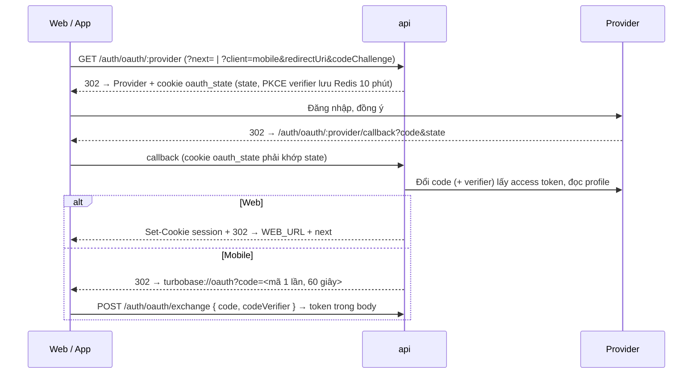

# Xác thực

## Quy tắc

- **Mặc định chặn**: `AuthGuard` là guard global của api và socket → mọi route HTTP cần access token. Route mở cho khách: `@Public()` (đang có: `/health*`, `/auth/register|login|refresh|logout`).
- Phân quyền: `@Roles(Role.ADMIN)` trên controller / route (403 nếu sai role). Người đang đăng nhập: `@CurrentUser() user: AuthUser` (`{ id, sessionId, role }`).
- **Không bao giờ** trả `passwordHash` ra ngoài: query user dùng `omit: { passwordHash: true }`. Field / model đánh dấu `/// @private` trong `schema.prisma` không được sinh vào `@repo/types` (web / mobile không thấy).
- Socket: kết nối phải có access token (cookie hoặc `auth: { token }`) của session chưa bị thu hồi; không có / sai / đã thu hồi → `connect_error` `unauthorized`. Chỉ kiểm tra lúc kết nối: kết nối đang mở không bị đóng khi session kết thúc.

## Mô hình token

| Token   | Dạng                              | Sống                                                  | Lưu ở server                                |
| ------- | --------------------------------- | ----------------------------------------------------- | ------------------------------------------- |
| Access  | JWT HS256 (`sub`, `sid`, `role`)  | `ACCESS_TOKEN_TTL_SECONDS` (15 phút)                  | Redis: `sid` đã thu hồi (`RevokedSessions`) |
| Refresh | `<sessionId>.<secret>` ngẫu nhiên | `REFRESH_TOKEN_TTL_DAYS` (30 ngày, trượt khi refresh) | Bảng `sessions`: chỉ sha256 của secret      |

- Mật khẩu: **argon2id** (`node:crypto`, không native addon), định dạng PHC `$argon2id$v=19$m=19456,t=2,p=1$…` (mức tối thiểu OWASP). Tham số lưu trong hash → nâng sau được, `needsRehash` tự hash lại khi user đăng nhập.
- **Xoay refresh token** mỗi lần refresh. Token vừa bị thay vẫn được chấp nhận **60 giây** (2 tab refresh cùng lúc). Token cũ hơn bị dùng lại = bị đánh cắp → **thu hồi cả session**.
- Đăng xuất / đổi mật khẩu / phát hiện refresh token bị dùng lại: session bị thu hồi trong DB **và** `sid` được ghi vào Redis (`auth:revoked-session:<sid>`, TTL = `ACCESS_TOKEN_TTL_SECONDS`). `AuthGuard` và `socketAuth` kiểm tra key này sau khi verify chữ ký → access token đã phát bị từ chối ngay. Redis lỗi → request lỗi (fail closed). Xem [ADR 0010](../decisions/0010-thu-hoi-session-ngay-qua-redis.md).
- Đăng xuất chỉ thu hồi khi refresh token đúng (biết `sessionId` thôi thì không đủ).
- Đổi mật khẩu: đăng xuất mọi thiết bị khác.

## Theo client

```mermaid
sequenceDiagram
  participant B as Browser
  participant W as Next (proxy.ts, RSC)
  participant A as api
  B->>A: POST /auth/login (credentials: include)
  A-->>B: Set-Cookie access_token, refresh_token (httpOnly, SameSite=Lax)
  B->>W: GET /hellos (cookies)
  alt access_token hết hạn, còn refresh_token
    W->>A: POST /auth/refresh (forward Cookie)
    A-->>W: Set-Cookie mới
    W-->>B: Set-Cookie mới + render với token mới
  end
  W->>A: RSC / Server Action: apiFetch + Cookie của request
  B->>A: TanStack Query: apiFetch (cookies); 401 → /auth/refresh → retry, hỏng → /login
```

| Client                           | Gửi token                                                                                     | Lưu token                                 | Refresh                                                                                                  |
| -------------------------------- | --------------------------------------------------------------------------------------------- | ----------------------------------------- | -------------------------------------------------------------------------------------------------------- |
| Web (browser)                    | Cookie httpOnly `access_token`                                                                | Cookie (JS không đọc được)                | `proxy.ts` trước khi render; browser: `apiFetch` tự refresh 1 lần khi 401 (`lib/auth.ts`, single flight) |
| Web (server: RSC, Server Action) | Forward header `Cookie` của request (`lib/api-server.ts`, đăng ký trong `instrumentation.ts`) | –                                         | `proxy.ts` đã refresh trước                                                                              |
| Socket (web)                     | Cookie (`withCredentials`)                                                                    | –                                         | `connect_error unauthorized` → refresh → `connect()` lại 1 lần                                           |
| Mobile                           | `Authorization: Bearer`, header `x-auth-transport: token` khi gọi `/auth/*`                   | `expo-secure-store` (Keychain / Keystore) | `apiFetch` refresh 1 lần khi 401; hỏng → về màn login (`Stack.Protected`)                                |

- Trang không cần đăng nhập của web: `PUBLIC_PATHS` trong `apps/web/proxy.ts` (đang có `/login`, `/register`). `?next=` chỉ nhận path cùng site (`safeNext`, chống open redirect).
- CSRF: cookie `SameSite=Lax` → browser không gửi cookie kèm request POST/PATCH/DELETE xuất phát từ site khác; CORS chỉ cho `CORS_ORIGINS` đọc response. Web và api phải **cùng site** (vd. `app.example.com` + `api.example.com`).

## Cấu hình

| Biến                                                     | App                | Mặc định                    | Ghi chú                                                                                                                                                     |
| -------------------------------------------------------- | ------------------ | --------------------------- | ----------------------------------------------------------------------------------------------------------------------------------------------------------- |
| `JWT_SECRET`                                             | api, socket        | – (bắt buộc, ≥ 32 ký tự)    | **Cùng giá trị** ở api và socket: `openssl rand -base64 48`                                                                                                 |
| `ACCESS_TOKEN_TTL_SECONDS`                               | api                | `900`                       |                                                                                                                                                             |
| `REFRESH_TOKEN_TTL_DAYS`                                 | api                | `30`                        |                                                                                                                                                             |
| `AUTH_REGISTRATION`                                      | api                | `closed`                    | `open`: ai cũng `POST /auth/register` được                                                                                                                  |
| `AUTH_RATE_LIMIT`                                        | api                | `10`                        | Số lần login / register / đổi mật khẩu mỗi IP mỗi phút                                                                                                      |
| `COOKIE_DOMAIN`                                          | api                | rỗng                        | **Bắt buộc** khi web và api khác host: domain cha (`example.com`) để cookie gửi được cho cả hai                                                             |
| `PUBLIC_API_URL`                                         | api                | `http://localhost:3001/api` | URL công khai của api (gồm `/api`): redirect URI của provider = `<PUBLIC_API_URL>/auth/oauth/<provider>/callback`. **Bắt buộc** ở stg/prod khi bật provider |
| `WEB_URL`                                                | api                | `http://localhost:3000`     | Trình duyệt về đây sau khi đăng nhập bằng provider. **Bắt buộc** ở stg/prod khi bật provider                                                                |
| `OAUTH_MOBILE_REDIRECT_URIS`                             | api                | `turbobase://oauth`         | Danh sách URL app (khớp chính xác) mà luồng mobile được quay về                                                                                             |
| `OAUTH_<GOOGLE\|FACEBOOK\|GITHUB>_CLIENT_ID` / `_SECRET` | api                | rỗng                        | Provider bật khi có **cả** id và secret. Secret chỉ ở `.env` / biến CI                                                                                      |
| `ADMIN_EMAIL`, `ADMIN_USERNAME`, `ADMIN_PASSWORD`        | `packages/db/.env` | –                           | `pnpm db:seed` tạo admin đầu tiên nếu chưa có                                                                                                               |

Cookie có `Secure` ở mọi `APP_ENV` trừ `dev` (`env.cookieSecure`).

Tên cookie theo `APP_ENV` (`authCookieNames` trong `@repo/utils`, api/socket: `env.authCookies`, web: `authCookies` trong `lib/env.ts`): prod giữ `access_token` / `refresh_token`, môi trường khác có tiền tố (`stg_access_token`, `dev_access_token`). Lý do: prod đặt cookie trên domain cha (`COOKIE_DOMAIN=example.com`) nên trình duyệt gửi cả sang `*.stg.example.com`; trùng tên sẽ lẫn phiên và đưa token prod cho stg. **KHÔNG ĐƯỢC** viết cứng tên cookie trong code.

## Đăng nhập bằng Google / Facebook / GitHub

Xem [ADR 0011](../decisions/0011-dang-nhap-bang-provider-qua-api.md). api chạy luồng OAuth 2.0 authorization code + PKCE (`apps/api/src/oauth`); client secret không rời api.



- `GET /auth/methods` → `{ providers, registration }`: màn đăng nhập chỉ hiện nút của provider đã bật và tab Đăng ký khi `AUTH_REGISTRATION=open`.
- **Liên kết tài khoản** (`OAuthService.userFor`), theo thứ tự:
  1. Đã có `UserIdentity (provider, subject)` → đăng nhập user đó. `subject` là id cố định của provider, **không** phải email.
  2. Có user cùng email → **chỉ** liên kết khi provider xác nhận email (Google `email_verified`, GitHub email primary + verified). Facebook không có cờ này nên **không bao giờ** tự liên kết theo email Facebook. Không xác nhận → lỗi `email_not_verified`.
  3. Chưa có → tạo user mới (lỗi `registration_closed` nếu `AUTH_REGISTRATION=closed`). Email chưa xác nhận **không** được gán vào user mới (tránh chiếm email của người khác).
- Lỗi trả về client dạng `?error=<code>` (`OAuthErrorCode`); câu chữ hiển thị: `oauthErrorMessage` trong `@repo/utils`.
- Chống login CSRF: `state` ngẫu nhiên, dùng 1 lần (`GETDEL` trong Redis), và phải khớp cookie `oauth_state` (httpOnly, host-only) của trình duyệt đã bắt đầu luồng.
- Mobile: mở trình duyệt hệ thống (`expo-web-browser`), PKCE giữa app và api (`lib/oauth.ts`): mã trong URL app vô dụng nếu thiếu verifier, nên app khác chặn được custom scheme cũng không đổi được mã. Bản Expo web chỉ có form mật khẩu. Expo Go dùng URL `exp://…/--/oauth`: thêm vào `OAUTH_MOBILE_REDIRECT_URIS` khi dev.

### Đăng ký app ở provider

| Provider | Nơi tạo                                                         | Redirect URI                                    | Scope                                                   |
| -------- | --------------------------------------------------------------- | ----------------------------------------------- | ------------------------------------------------------- |
| Google   | Google Cloud Console → APIs & Services → Credentials (Web)      | `<PUBLIC_API_URL>/auth/oauth/google/callback`   | `openid email profile`                                  |
| GitHub   | Settings → Developer settings → OAuth Apps **hoặc** GitHub Apps | `<PUBLIC_API_URL>/auth/oauth/github/callback`   | OAuth App: `read:user user:email`; GitHub App: xem dưới |
| Facebook | Meta for Developers → app → Facebook Login                      | `<PUBLIC_API_URL>/auth/oauth/facebook/callback` | `email public_profile`                                  |

Facebook gọi Graph API không kèm version: dùng version mặc định cài trong app dashboard.

GitHub:

- **OAuth App** (Client ID `Ov23…`): một callback URL mỗi app → tạo app riêng cho local / stg / prod. Scope trong URL authorize có hiệu lực.
- **GitHub App** (Client ID `Iv23…`): **bỏ qua scope**, quyền lấy từ cấu hình app. **PHẢI** bật _Permissions & events → Account permissions → Email addresses: Read-only_; thiếu → `GET /user/emails` trả 403, log api `GITHUB: https://api.github.com/user/emails answered 403`, người dùng thấy lỗi `provider_error`. Cho nhiều callback URL; không cần cài app vào repo nào.

Mỗi môi trường một client (ít nhất tách prod): secret của local nằm trên máy dev, lộ thì chỉ revoke client đó. Đổi port api → sửa redirect URI ở provider (khớp chính xác scheme / host / port / path).

### Thêm provider khác (Keycloak, Microsoft…)

1. Thêm giá trị vào enum `OAuthProvider` (migration) và cấu hình trong `PROVIDERS` (`oauth.providers.ts`): URL authorize / token, scope, hàm đọc profile trả `{ subject, email, emailVerified, name }`.
2. Thêm biến `OAUTH_<NAME>_CLIENT_ID` / `_SECRET` vào `env.ts` + `credentialsOf`.
3. Thêm nút trong `SIGN_IN_PROVIDERS` (`@repo/utils`).

## Test

- `@repo/auth`: unit test (argon2id kể cả vector chuẩn, JWT, `RevokedSessions`, guard, socket middleware).
- api: `test/auth.e2e-spec.ts` (cookie / token mode, xoay token, phát hiện dùng lại, đăng xuất, đổi mật khẩu; access token bị từ chối ngay sau khi session kết thúc). `test/oauth.e2e-spec.ts`: luồng provider với Google / GitHub giả (stub `fetch`): PKCE, state dùng 1 lần, cookie `oauth_state`, `next` ngoài site, quy tắc liên kết, registration closed, luồng mobile + exchange. socket: `test/chat.e2e-spec.ts` từ chối token của session đã thu hồi. Route khác trong e2e dùng `bearer(app)` từ `test/create-app.ts`.
- Controller có guard trong unit test: `overrideGuard(...)` nếu cần.
- Playwright: project `setup` (`tests/auth.setup.ts`) đăng ký + đăng nhập qua UI một lần, lưu cookie vào `.auth/user.json`; test khác dùng lại. Test đăng xuất **PHẢI** tự đăng nhập session riêng: đăng xuất session dùng chung làm các test chạy song song nhận 401. `tests/auth.spec.ts`: chuyển hướng login, sai mật khẩu, tab đăng ký + tạo tài khoản, thông báo lỗi provider, refresh trước khi render, đăng xuất. Playwright nâng `AUTH_RATE_LIMIT` (nhiều test đăng nhập trong 1 phút). Không có test với provider thật.
- mobile: `src/lib/oauth.spec.ts` (PKCE, đổi mã, huỷ, lỗi), `session.spec.ts` (đăng ký).

## Lưu ý khi dev

- `nest start --watch` chỉ theo dõi `src/` của app: sửa `packages/auth` (hay package khác) → **restart** `pnpm dev` để api / socket nạp `dist/` mới.
