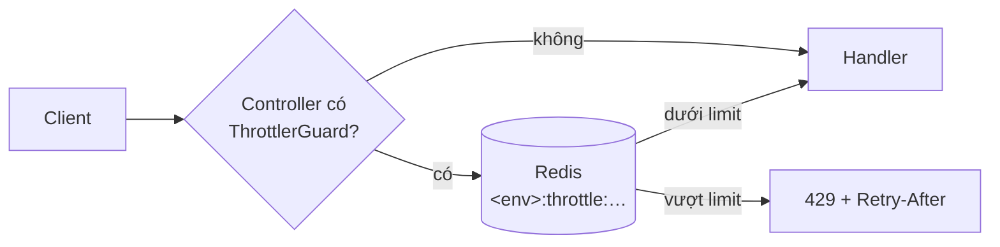

# Rate limit cho api

## Quy tắc

**Rate limit là opt-in theo controller.** Không có guard global: controller nào không gắn `ThrottlerGuard` thì **không bị limit**.

> Controller mới nhận request từ bên ngoài (client, đối tác, public) → **phải** gắn `@UseGuards(ThrottlerGuard)`.

| Loại controller                                     | Gắn guard?                 | Ví dụ hiện có     |
| --------------------------------------------------- | -------------------------- | ----------------- |
| API cho web / mobile / public                       | Có                         | `hellos`, `files` |
| Login, OTP, quên mật khẩu, gửi mail/SMS             | Có + `strict` (xem dưới)   | –                 |
| Health probe, metrics (load balancer, orchestrator) | Không                      | `health`          |
| Webhook từ đối tác (có xác thực chữ ký)             | Tuỳ: không, hoặc limit cao | –                 |

## Cách dùng

```ts
import { Controller, UseGuards } from '@nestjs/common'
import { SkipThrottle, Throttle, ThrottlerGuard } from '@nestjs/throttler'

// 1. Bật cho cả controller: mức mặc định RATE_LIMIT / RATE_LIMIT_TTL_SECONDS theo IP
@UseGuards(ThrottlerGuard)
@Controller('orders')
export class OrdersController {
  // 2. Đổi mức cho một route (ttl tính bằng ms)
  @Throttle({ default: { limit: 10, ttl: 60_000 } })
  @Post()
  create() {}

  // 3. Bỏ limit cho một route trong controller đã gắn guard
  @SkipThrottle()
  @Get('public-config')
  config() {}
}
```

- `@Throttle()` đặt ở class thì áp cho mọi route của controller đó.
- Unit test controller có guard: testing module không có `ThrottlerModule`, override guard:

  ```ts
  await Test.createTestingModule({ controllers: [OrdersController], providers: [...] })
    .overrideGuard(ThrottlerGuard)
    .useValue({ canActivate: () => true })
    .compile()
  ```

- Hành vi limit thật (header, 429) kiểm tra trong e2e (`apps/api/test/security.e2e-spec.ts`).

## Cấu hình (env của api)

| Biến                     | Mặc định | Ý nghĩa                                                                                                                             |
| ------------------------ | -------- | ----------------------------------------------------------------------------------------------------------------------------------- |
| `RATE_LIMIT`             | `100`    | Số request tối đa / IP / cửa sổ (mức `default`)                                                                                     |
| `RATE_LIMIT_TTL_SECONDS` | `60`     | Độ dài cửa sổ; vượt limit thì IP bị chặn thêm đúng khoảng này                                                                       |
| `TRUST_PROXY`            | `0`      | Số proxy phía trước (load balancer, ingress). **Phải đặt** khi chạy sau proxy, nếu không mọi client chung một bộ đếm (IP của proxy) |

Response của route có guard kèm header `X-RateLimit-Limit`, `X-RateLimit-Remaining`, `X-RateLimit-Reset`; khi bị chặn: `429` + `Retry-After` (giây).

## Cách hoạt động



- Bộ đếm nằm trong Redis (`RedisThrottlerStorage` từ `@repo/redis`): mọi instance api dùng chung, scale ngang không làm limit nhân lên.
- Fixed window, một Lua script atomic mỗi request (1 round trip). Key: `<APP_ENV>:throttle:<throttler>:<hash>` (hash = controller + handler + IP), tự hết hạn.
- Redis không trả lời → request lỗi (guard throw). Redis đã là dependency bắt buộc của api (`/health/ready` kiểm tra).

## Lưu ý

- **SSR của web dùng chung một bộ đếm**: Server Component / Server Action gọi api từ IP của server Next. Trang SSR gọi nhiều → tăng limit cho route đó, hoặc `@SkipThrottle()` nếu route chỉ web server gọi.
- **e2e / Playwright** chạy mọi request từ localhost: `RATE_LIMIT=100000` trong `apps/api/vitest.e2e.config.ts` và `apps/e2e/playwright.config.ts`. Test chạy với `APP_ENV=dev` nên chung prefix `dev:` với máy dev; thử tay ngay sau khi chạy e2e có thể bị 429 tới khi cửa sổ hết hạn.
- Thêm mức limit khác (vd. `strict` cho auth): khai báo thêm phần tử trong `throttlers` của `ThrottlerModule.forRootAsync` (`app.module.ts`). `@nestjs/throttler` áp **mọi** throttler đã khai báo cho mọi route có guard, nên route thường phải bỏ mức mới bằng `@SkipThrottle({ strict: true })` hoặc dùng `skipIf` khi khai báo.

## Vì sao opt-in (không dùng guard global)

- Linh hoạt: bật/tắt theo controller, không cần danh sách loại trừ (health, webhook, metrics…).
- Đánh đổi: endpoint mới **không tự được bảo vệ** → quy tắc ở đầu tài liệu + checklist review (`AGENTS.md`).
