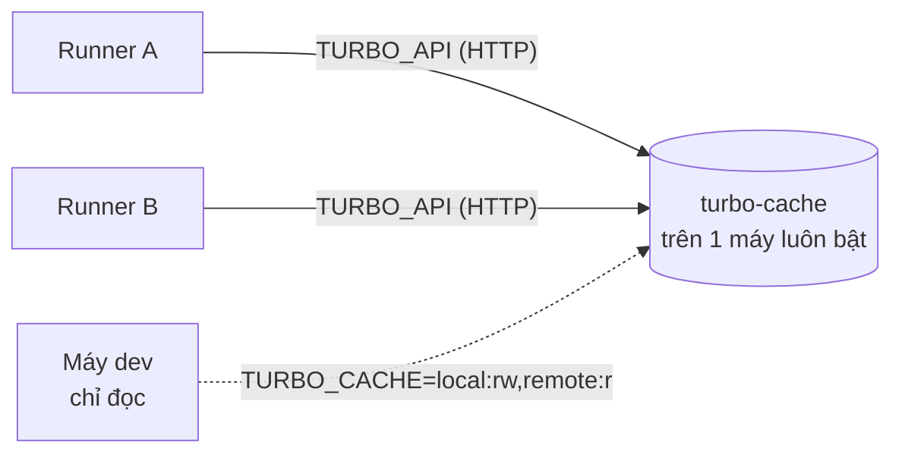

# Cache build/check cho CI

Turbo bỏ qua task (`build`, `lint`, `check-types`, `test`) nếu hash input (file tracked + lockfile + env khai báo) đã có kết quả trong cache. Mặc định cache nằm ở đĩa từng máy, nên **mỗi GitLab runner có cache riêng** và job rơi vào runner khác sẽ chạy lại từ đầu. Remote Cache là một HTTP server dùng chung cho mọi runner.



- Runner nào chạy task trước thì upload kết quả, runner khác tải về. Không cần build trước ở máy đặt server.
- Server tắt hoặc không gọi được: turbo in `WARNING could not connect to the cache` rồi chạy task bình thường, pipeline không fail vì cache.
- Không cần domain hay HTTPS: `TURBO_API` là bất kỳ URL nào runner gọi tới được (IP LAN, IP VPN).

## Cài server (một lần)

Trên một máy luôn bật mà mọi runner gọi được (nên đặt IP tĩnh / DHCP reservation):

```bash
export TURBO_TOKEN=$(openssl rand -hex 32)   # lưu lại, dùng cho bước sau
docker compose -f deploy/turbo-cache/docker-compose.yml up -d
curl http://<ip-máy>:3000/v8/artifacts/status  # {"status":"enabled"}
```

- Image `ducktors/turborepo-remote-cache` (pin version trong compose), lưu artifact vào volume `turbo-cache`.
- Đổi port: `TURBO_CACHE_PORT=4000 docker compose … up -d`.
- Runner Docker executor chạy trên **chính máy này** phải gọi bằng IP LAN, không dùng `localhost` (đó là localhost của container job).
- Mở port từ firewall chỉ cho dải IP của runner/dev.

## Cấu hình GitLab

Settings → CI/CD → Variables:

| Biến          | Giá trị                | Cờ     |
| ------------- | ---------------------- | ------ |
| `TURBO_API`   | `http://<ip-máy>:3000` | –      |
| `TURBO_TOKEN` | token đã tạo ở trên    | Masked |

`TURBO_TEAM: ci` đã khai báo trong `.gitlab-ci.yml` (namespace trên server). Không đặt `TURBO_API`/`TURBO_TOKEN` thì turbo báo `Remote caching disabled` và chạy như trước.

Kiểm tra: chạy lại pipeline của cùng một commit, log job `check` có dòng `Cached: N cached, N total` / `FULL TURBO`.

## Dùng ở máy dev (tuỳ chọn, chỉ đọc)

Dev đọc cache do CI ghi để `pnpm turbo run …` / pre-push nhanh hơn, nhưng **không ghi lên**: turbo hash cả file chưa commit trong working tree, nên kết quả từ máy dev có thể không khớp với commit thật.

```bash
# ~/.bashrc hoặc .envrc (không commit token)
export TURBO_API=http://<ip-máy>:3000 TURBO_TEAM=ci TURBO_TOKEN=<token>
export TURBO_CACHE=local:rw,remote:r
```

## Vận hành

- Dung lượng tăng dần, server không tự xoá. Dọn định kỳ (cron trên máy server):
  ```bash
  docker run --rm -v turbo-cache_turbo-cache:/tmp alpine \
    find /tmp/turbo-cache -type f -mtime +14 -delete
  ```
- Đổi token: sửa `TURBO_TOKEN`, `docker compose … up -d`, cập nhật CI/CD variable. Server nhận nhiều token cách nhau bằng dấu phẩy (`old,new`) để chuyển dần.
- Xoá sạch cache (nghi cache hỏng): `docker compose -f deploy/turbo-cache/docker-compose.yml down -v`.
- GitHub Actions (`.github/workflows/ci.yml`) chạy trên runner của GitHub, không gọi được server trong LAN, nên vẫn dùng `actions/cache`.
- Build image Docker (`deploy/*.Dockerfile`) không dùng Remote Cache; tầng image được cache qua `--cache-from` registry.
