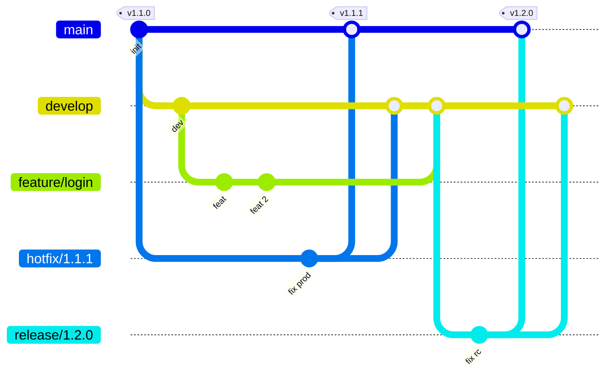

# GitFlow

Quy trình nhánh của dự án. Các luật bên dưới **được CI kiểm tra tự động** – MR/PR sai luật sẽ fail job `gitflow`.

## Tổng quan



## Các nhánh

| Nhánh                                              | Tách từ                              | Merge vào                                       | Sống              | Ghi chú                                                   |
| -------------------------------------------------- | ------------------------------------ | ----------------------------------------------- | ----------------- | --------------------------------------------------------- |
| `main`                                             | –                                    | –                                               | lâu dài           | Code đang chạy production. Mỗi lần merge = 1 tag `vX.Y.Z` |
| `develop`                                          | `main`                               | –                                               | lâu dài           | Nhánh tích hợp, luôn build được                           |
| `feature/<tên>`                                    | `develop`                            | `develop`                                       | ngắn              | Tính năng mới                                             |
| `fix/<tên>`                                        | `develop` / `release/*` / `hotfix/*` | nhánh nó tách ra                                | ngắn              | Sửa lỗi chưa lên production                               |
| `chore/` `docs/` `refactor/` `test/` `ci/` `deps/` | `develop`                            | `develop`                                       | ngắn              | Việc không đổi hành vi; `deps/*` do Renovate tạo          |
| `release/X.Y.Z`                                    | `develop`                            | `main` **và** `develop`                         | đến khi phát hành | Đóng băng tính năng, chỉ nhận `fix/*`                     |
| `hotfix/X.Y.Z`                                     | `main`                               | `main` **và** `develop` (+ `release/*` đang mở) | rất ngắn          | Sửa lỗi khẩn cấp trên production                          |

Đặt tên: chữ thường, số, `.` `_` `-` (vd. `feature/hello-pagination`). `release/` và `hotfix/` **bắt buộc** đúng `X.Y.Z` vì version này thành tag.

Tên nhánh được kiểm tra ở 3 chỗ, cùng một luật (`scripts/gitflow-check.sh --branch <tên>`):

| Khi                                 | Hook / job            | Hành vi                                                    |
| ----------------------------------- | --------------------- | ---------------------------------------------------------- |
| `git checkout -b` / `git switch -c` | husky `post-checkout` | Báo lỗi + gợi ý lệnh đổi tên (git không cho chặn checkout) |
| `git push`                          | husky `pre-push`      | **Chặn** push nhánh sai tên (trước lint/test)              |
| MR / PR                             | CI job `gitflow`      | Chặn merge (tên + luật nguồn → đích)                       |

```text
$ git checkout -b Feature/Login
Switched to a new branch 'Feature/Login'
✖ GitFlow: branch name 'Feature/Login' is not allowed.
  Rename:  git branch -m 'Feature/Login' feature/login
```

## Ai được merge vào đâu

Kiểm tra bởi `scripts/gitflow-check.sh <nguồn> <đích>` (chạy local được):

| Đích                    | Nguồn hợp lệ                                                                                                         |
| ----------------------- | -------------------------------------------------------------------------------------------------------------------- |
| `main`                  | `release/X.Y.Z`, `hotfix/X.Y.Z`                                                                                      |
| `develop`               | `feature/*`, `fix/*`, `chore/*`, `docs/*`, `refactor/*`, `test/*`, `ci/*`, `deps/*`, `release/*`, `hotfix/*`, `main` |
| `release/*`, `hotfix/*` | `fix/*`                                                                                                              |
| nhánh làm việc khác     | nhánh làm việc (stack: `feature/a` → `feature/b`)                                                                    |

```bash
sh scripts/gitflow-check.sh feature/login develop   # ✔
sh scripts/gitflow-check.sh feature/login main      # ✖ Only release/* and hotfix/* merge into main.
```

## Luồng làm việc

### Tính năng / sửa lỗi thường

```bash
git switch develop && git pull
git switch -c feature/hello-pagination
# … code, commit theo Conventional Commits
git push -u origin feature/hello-pagination
# Mở MR/PR → develop (mẫu Default), chờ check + review, squash/merge
```

### Phát hành (release)

1. Tách `release/X.Y.Z` từ `develop` khi đủ tính năng cho bản này.
2. Push → CI build image `:stg` → QA test trên stg. Lỗi → `fix/*` từ `release/X.Y.Z`, MR vào lại `release/X.Y.Z`.
3. MR `release/X.Y.Z` → `main` (mẫu **Release**), merge.
4. Tag trên `main`: `git tag vX.Y.Z && git push origin vX.Y.Z` → CI build image `:prod`, `:X.Y.Z`, `:latest` (**cần duyệt tay**).
5. Merge `release/X.Y.Z` (hoặc `main`) ngược về `develop`, xoá nhánh release.

### Hotfix

1. Tách `hotfix/X.Y.Z` từ `main` (tăng PATCH so với bản prod hiện tại).
2. Sửa tối thiểu → push → kiểm tra trên stg.
3. MR → `main` (mẫu **Hotfix**), merge, tag `vX.Y.Z` → duyệt build prod.
4. Merge `hotfix/X.Y.Z` vào `develop` (và `release/*` đang mở nếu có), xoá nhánh.

## Version (SemVer)

`vMAJOR.MINOR.PATCH` – tag **chỉ** đặt trên `main` (CI từ chối build prod nếu tag không nằm trên `main`).

| Tăng    | Khi                                                | Nhánh                     |
| ------- | -------------------------------------------------- | ------------------------- |
| `MAJOR` | Breaking change: API, socket event, env, schema DB | `release`                 |
| `MINOR` | Tính năng mới, tương thích ngược                   | `release`                 |
| `PATCH` | Chỉ sửa lỗi                                        | `hotfix` (hoặc `release`) |

## Commit

[Conventional Commits](https://www.conventionalcommits.org), kiểm tra bởi commitlint (hook `commit-msg`):

```text
<type>(<scope>): <mô tả ngắn, ≤ 72 ký tự>

feat(api): add hellos pagination
fix(web): show api validation errors
chore(deps): update nestjs to 12.3.0
```

- `type`: `feat`, `fix`, `refactor`, `perf`, `docs`, `test`, `chore`, `ci`, `build`, `style`, `revert`.
- `scope` (gợi ý, sai chỉ cảnh báo): `api`, `socket`, `web`, `ui`, `db`, `decorators`, `utils`, `socket-events`, `eslint-config`, `typescript-config`, `deploy`, `deps`, `ci`.
- Hooks local: `post-checkout` (kiểm tra tên nhánh), `pre-commit` (Prettier các file commit), `commit-msg` (commitlint), `pre-push` (tên nhánh, rồi `lint`, `check-types`, `test`).

## CI/CD theo nhánh

| Sự kiện                              | Chạy                        | Image (môi trường)                  |
| ------------------------------------ | --------------------------- | ----------------------------------- |
| MR / PR                              | `gitflow` + `check`         | –                                   |
| push `develop`                       | `check` → images            | `:dev` (dev)                        |
| push `release/X.Y.Z`, `hotfix/X.Y.Z` | `check` → images            | `:stg` (stg)                        |
| push `main`                          | `check`                     | –                                   |
| tag `vX.Y.Z` trên `main`             | `check` → images, duyệt tay | `:prod`, `:X.Y.Z`, `:latest` (prod) |

`check` = format, build, lint, type-check, test, migration apply + khớp `schema.prisma`. Chi tiết: README mục _CI/CD_.

## Bảo vệ nhánh

| Nhánh                           | Push thẳng         | Force push | Xoá               |
| ------------------------------- | ------------------ | ---------- | ----------------- |
| `main`, `master`, `develop`     | ✖ (chỉ qua MR/PR)  | ✖          | ✖                 |
| `release/X.Y.Z`, `hotfix/X.Y.Z` | ✔                  | ✖          | ✔ (sau khi merge) |
| `feature/*`, `fix/*`, …         | ✔                  | ✔ (rebase) | ✔                 |
| tag `vX.Y.Z`                    | chỉ maintainer tạo | ✖          | ✖                 |

Hai lớp:

1. **Local – husky `pre-push`** (`scripts/gitflow-check.sh --push`): báo sớm, nhưng **bỏ qua được** bằng `git push --no-verify` hoặc máy chưa cài hook. Maintainer cần push đặc biệt (khởi tạo repo…): `ALLOW_PROTECTED_PUSH=1 git push …`.
2. **Server – lớp chặn thật** (cấu hình một lần khi tạo repo):
   - **GitLab:** `GITLAB_TOKEN=glpat-… sh scripts/gitlab-protect.sh <group/project>` (xem trước: `DRY_RUN=1`). Protect `main`/`master`/`develop` (push: không ai, merge: maintainer/developer), `release/*`, `hotfix/*` (cấm force push), tag `v*` (maintainer), MR chỉ merge khi pipeline xanh.
   - **GitHub:** Settings → Rules → Rulesets → _Import a ruleset_, lần lượt các file trong `.github/rulesets/` (`protected-branches.json` – bắt buộc PR + 1 approve + check `gitflow`, `check`, `e2e`; `release-branches.json`; `release-tags.json`). Environment `prod`: thêm _Required reviewers_.
   - Nhánh mặc định cho MR/PR mới: `develop`.
