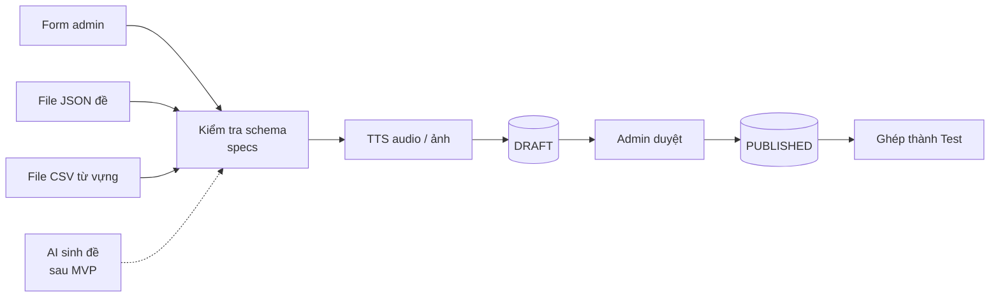
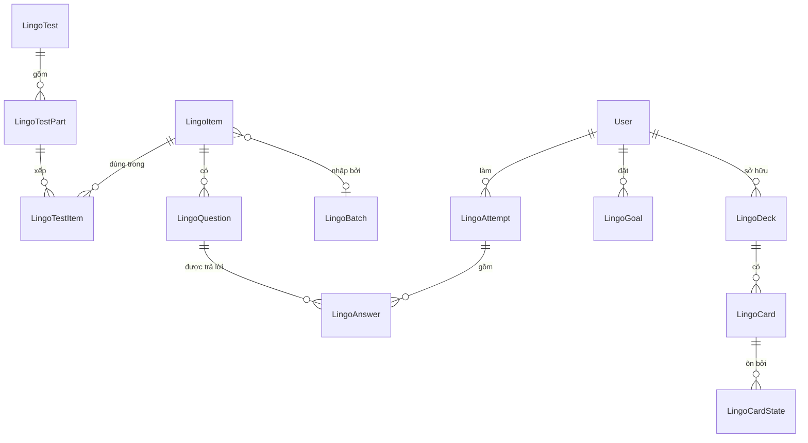

# Lingo – app học ngoại ngữ và luyện thi

App trong launcher (`/lingo`), cạnh Studio (Hellos, Chat, Files là code tham khảo: ẩn khỏi launcher, vẫn mở bằng URL). App học ngoại ngữ và luyện thi
chứng chỉ, dùng chung cho nhiều kỳ thi. **TOEIC Listening & Reading** làm đầu tiên. Thiết kế phải thêm được **IELTS**,
**HSK** (và về sau TOPIK, JLPT…) mà không đổi schema hay viết lại màn làm bài.

Tập thể dục (gym) là **app riêng** về sau (vd. `Fit`, `/fit`), không nằm trong Lingo. Phần có thể dùng chung
(mục tiêu, streak, nhắc học mỗi ngày) chỉ tách thành package khi app thứ hai thật sự cần.

> **Trạng thái:** đã làm giai đoạn 1, đủ 7 Part TOEIC, bộ đề trong DB, AI sinh câu / đề / thẻ (BytePlus, ADR 0017).
> Phần Nghe tạm đọc bằng giọng của trình duyệt; TTS thật (mục 5.3) chưa làm.

## 1. Tham khảo study4.com

Ghi chú từ các trang công khai của study4.com, đọc ngày 2026-11-18. Không xem được phần cần đăng nhập.

| Study4 có                                                                                                               | Lingo lấy gì                                                        |
| ----------------------------------------------------------------------------------------------------------------------- | ------------------------------------------------------------------- |
| Thư viện đề, lọc theo kỳ thi (IELTS, TOEIC, HSK 1–6, TOPIK, JLPT…), tìm kiếm, mỗi đề có số lượt làm và số bình luận     | Thư viện đề theo kỳ thi, có lọc và tìm kiếm (bình luận để sau)      |
| Trang đề có 2 chế độ: **Luyện tập** (chọn Part và giới hạn thời gian) và **Full test** (chỉ chế độ này có điểm quy đổi) | Giữ nguyên 2 chế độ này                                             |
| Mỗi Part gắn tag dạng câu (vd. `[Listening] Note/Form Completion`)                                                      | Tag dạng câu, dùng để thống kê điểm yếu                             |
| Đề rút gọn (`/tests/mini`)                                                                                              | Mini test                                                           |
| Flashcard: bộ có sẵn theo kỳ thi; tạo thẻ từ **highlight** ở trang kết quả bài thi                                      | Bộ thẻ hệ thống + bộ thẻ của tôi + thêm thẻ từ highlight            |
| [Unverified] Quảng cáo: ôn flashcard theo spaced repetition, thống kê theo ngày và dạng câu, AI chấm Speaking/Writing   | SRS (FSRS), thống kê theo dạng câu; AI chấm Writing ở giai đoạn sau |
| Khoá học trả phí, trợ giảng, cộng đồng                                                                                  | Ngoài phạm vi                                                       |

Khác study4: đề do admin tự soạn và duyệt (không sao chép đề có bản quyền), giải thích bằng tiếng Việt cho mọi câu.
AI sinh đề là giai đoạn sau, dùng chung đường nhập và bước duyệt.

## 2. Phạm vi

| Trong MVP (TOEIC)                                                  | Sau MVP                                        |
| ------------------------------------------------------------------ | ---------------------------------------------- |
| Thư viện đề TOEIC: full test và mini test, luyện theo Part         | IELTS (Listening, Reading, rồi Writing)        |
| Từ vựng: bộ thẻ hệ thống + bộ của tôi, ôn SRS, thêm từ highlight   | HSK 1–6 (thẻ có pinyin và chữ Hán)             |
| Chấm, giải thích tiếng Việt, transcript, xem lại bài               | AI chấm Writing; Speaking (cần speech-to-text) |
| Điểm dự đoán, điểm yếu theo Part và dạng câu, mục tiêu theo kỳ thi | Bình luận dưới đề, app mobile                  |
| Admin: nhập đề (form, JSON), từ vựng (CSV), duyệt, ghép đề         | AI sinh đề, AI điền thẻ; thanh toán            |

Người dùng: mọi tài khoản đã đăng nhập. Tiến độ riêng từng người. Đề và bộ thẻ hệ thống dùng chung.

## 3. Mô hình chung cho nhiều kỳ thi

Ý chính: **cấu trúc kỳ thi là code, nội dung là dữ liệu.**

```
Exam (TOEIC_LR, IELTS_AC, HSK3…)         ← code: apps/api/src/lingo/specs
 └─ Section (Listening, Reading…)          thời gian, cách quy đổi điểm
     └─ Part (TOEIC Part 5, IELTS Recording 1, HSK 阅读 第一部分…)
         └─ dạng câu cho phép, số câu, tag dạng câu
Test (một đề)                             ← dữ liệu: DB
 └─ TestPart → Item (stimulus: văn bản / audio / ảnh)
                 └─ Question (dạng câu + đáp án + giải thích)
```

### 3.1 `apps/api/src/lingo/specs`

Mỗi kỳ thi là một file khai báo trong api (không tách package riêng, xem ADR 0012). Thêm kỳ thi = thêm một file + nội dung, không migration.

```ts
// apps/api/src/lingo/specs/toeic-lr.ts
export const toeicLr = defineExam({
  code: 'TOEIC_LR',
  name: 'TOEIC Listening & Reading',
  language: 'en',
  sections: [
    {
      code: 'L',
      name: 'Listening',
      minutes: 45,
      scoring: tableScore(TOEIC_L_TABLE), // số câu đúng → 5–495
      parts: [
        {
          code: 'P1',
          name: 'Photographs',
          count: 6,
          types: ['SINGLE_CHOICE'],
          media: ['image', 'audio'],
        },
        {
          code: 'P2',
          name: 'Question–Response',
          count: 25,
          types: ['SINGLE_CHOICE'],
          media: ['audio'],
          options: 3,
        },
        // P3, P4…
      ],
    },
    {
      code: 'R',
      name: 'Reading',
      minutes: 75,
      scoring: tableScore(TOEIC_R_TABLE),
      parts: [/* P5, P6, P7 */],
    },
  ],
  total: sum, // 10–990
  skillTags: [
    'grammar.verb-tense',
    'grammar.word-form',
    'vocab.collocation',
    'reading.inference' /*…*/,
  ],
})
```

- Api dùng để kiểm tra khi nhập, chấm, quy đổi điểm. Web lấy cấu trúc qua `GET /lingo/exams/:exam` (kèm số câu đã xuất bản mỗi Part), không khai báo lại.
- Mỗi dạng câu có **schema Zod** (`specs/schemas.ts`): kiểm tra file nhập ở api, và structured output khi có AI sinh đề. Lỗi trả về theo từng dòng cho web.

### 3.2 Dạng câu (`QuestionType`)

| Dạng            | Dùng ở                                                                   | Chấm                   |
| --------------- | ------------------------------------------------------------------------ | ---------------------- |
| `SINGLE_CHOICE` | TOEIC mọi Part, IELTS multiple choice, HSK chọn đáp án                   | tự động                |
| `MULTI_CHOICE`  | IELTS "choose TWO letters"                                               | tự động                |
| `TRUE_FALSE_NG` | IELTS Reading True/False/Not Given, HSK nghe đúng/sai                    | tự động                |
| `GAP_FILL`      | IELTS form/note/table completion (gõ chữ, có danh sách đáp án chấp nhận) | tự động, chuẩn hoá chữ |
| `MATCHING`      | IELTS matching headings / features, HSK ghép câu – tranh                 | tự động                |
| `ORDERING`      | HSK sắp xếp từ thành câu                                                 | tự động                |
| `ESSAY`         | IELTS Writing, HSK viết đoạn                                             | AI chấm (sau MVP)      |
| `SPEAKING`      | IELTS Speaking                                                           | sau MVP                |

MVP chỉ cài `SINGLE_CHOICE`. Đáp án lưu dạng JSON theo schema của dạng câu, nên thêm dạng mới không đổi bảng.

### 3.3 Quy đổi điểm

Mỗi Section khai báo hàm quy đổi trong spec. [Unverified] Các bảng sau không có bản chính thức công khai đầy đủ, app luôn hiển thị là **điểm dự đoán**:

| Kỳ thi    | Thang                                      | Cách quy đổi trong app                     |
| --------- | ------------------------------------------ | ------------------------------------------ |
| TOEIC L&R | L 5–495, R 5–495, tổng 10–990              | bảng số câu đúng → điểm (ước tính)         |
| IELTS     | band 0–9 mỗi kỹ năng, overall làm tròn 0.5 | bảng raw /40 → band cho Listening, Reading |
| HSK       | theo cấp, có điểm đạt                      | điểm thô theo phần, tổng, đạt / chưa đạt   |

Giống study4: chỉ chế độ **Full test** mới có điểm quy đổi. Chế độ luyện chỉ có số câu đúng.

**Đã chốt:** MVP dùng bảng **ước tính** (số câu đúng → điểm, nội suy tuyến tính theo đoạn), khai báo trong
`specs` cạnh Section. Hiệu chỉnh bảng sau chỉ cần sửa spec; điểm đã lưu của các lần thi cũ giữ nguyên.

## 4. Tính năng

### 4.1 Hồ sơ theo kỳ thi

- Người học chọn kỳ thi đang ôn (có thể nhiều): mỗi kỳ có **mục tiêu** (TOEIC 650, IELTS 6.5, HSK 4 đạt) và **ngày thi** (tuỳ chọn).
- Dashboard theo kỳ thi đang chọn: thẻ cần ôn hôm nay, điểm dự đoán gần nhất và mục tiêu, 3 dạng câu yếu nhất, streak.

### 4.2 Thư viện đề (`/lingo/[exam]/tests`)

- Danh sách đề: tên, thời gian, số Part, số câu, số lượt làm, tag; lọc theo Section, tìm theo tên.
- Trang đề, 2 chế độ (như study4):
  - **Luyện tập:** chọn 1 hoặc nhiều Part, giới hạn thời gian (không giới hạn / 5–120 phút). Chấm khi nộp, có tuỳ chọn hiện đáp án ngay từng câu.
  - **Full test:** đủ Section, đúng thời gian, Listening chạy liền không tua. Có điểm quy đổi.
- Thêm **Luyện nhanh**: 10–20 câu ngẫu nhiên của 1 Part, ưu tiên câu chưa làm và dạng câu yếu.

### 4.3 Làm bài

- Màn tập trung: đồng hồ đếm ngược, bảng điều hướng câu, đánh dấu câu xem lại, phím tắt A/B/C/D.
- Highlight văn bản trong đề (Reading, transcript) để thêm vào flashcard sau.
- Tự lưu đáp án. Mất mạng hoặc đóng tab → vào lại làm tiếp.

### 4.4 Kết quả và xem lại

- Điểm (full test), số câu đúng theo Part và theo tag dạng câu, thời gian mỗi câu.
- Từng câu: đáp án đúng, giải thích tiếng Việt (vì sao đúng, vì sao từng đáp án sai, bẫy), dịch, **transcript** (Listening), từ vựng nổi bật.
- Câu sai vào **Sổ câu sai**, làm lại được. Nút "Báo câu sai" đổ về hàng chờ admin.

### 4.5 Từ vựng (SRS)

- **Bộ thẻ hệ thống** theo kỳ thi và chủ đề (TOEIC: Office, Finance…; IELTS: Environment, Education…; HSK: theo cấp).
- **Bộ thẻ của tôi:** tạo bộ, thêm thẻ tay, thêm từ **highlight** ở trang kết quả (người học tự gõ nghĩa; AI điền tự động ở giai đoạn AI).
- Mặt thẻ tuỳ ngôn ngữ: tiếng Anh có IPA; tiếng Trung có chữ Hán, **pinyin**, Hán Việt. Có audio phát âm.
- Ôn: lật thẻ → tự chấm **Again / Hard / Good / Easy**, lịch ôn theo FSRS (`ts-fsrs`). Giới hạn thẻ mới mỗi ngày.

### 4.6 Admin (role `ADMIN`)

- **Nhập nội dung:** form nhập từng item, nhập file JSON (đề), nhập file CSV (thẻ từ vựng). Xem mục 5.
- **Duyệt:** xem, sửa, nghe audio, Duyệt / Loại. Chỉ nội dung đã duyệt mới hiện cho người học.
- **Ghép đề:** chọn các Item đã duyệt theo cấu trúc spec thành một Test (có nút "ghép tự động đủ cấu trúc"), xuất bản.

### 4.7 Hỏi AI (`/lingo/chat`)

- Chat với gia sư AI về tiếng Anh / TOEIC: ngữ pháp, từ vựng, sửa câu, giải thích đáp án. Trả lời hiện dần (stream).
- Bong bóng nổi góc phải dưới trên mọi trang Lingo (trừ `/lingo/chat`): mở khung chat nhỏ, đóng vẫn trả lời tiếp, nút mở toàn trang.
- Hội thoại lưu lại, mỗi người chỉ thấy của mình; xoá được. Tiêu đề = câu hỏi đầu.
- Model: BytePlus ModelArk (`ARK_API_KEY`, `ARK_MODEL`), xem ADR `0016`. Thiếu cấu hình thì trang báo AI chưa bật.

## 5. Nhập nội dung

Mọi nguồn (kể cả AI) đi qua cùng một đường: kiểm tra bằng schema Zod của
`specs` → `DRAFT` → admin duyệt → `PUBLISHED`. Thêm nguồn mới (AI) không đổi phần còn lại.



### 5.1 Nguồn trong MVP

- **Form admin:** nhập một item (stimulus + câu hỏi + đáp án + giải thích), form dựng từ schema của Part.
- **File JSON đề:** mảng item theo schema của Part. Admin tự soạn, hoặc nhờ công cụ bất kỳ soạn rồi tải lên.
  Lỗi schema trả về theo từng dòng; item hợp lệ vẫn được nhập. Trùng `contentHash` thì bỏ qua.
- **File CSV từ vựng:** `term, pos, reading, meaningVi, example, exampleVi, topic` vào một bộ thẻ hệ thống.
  Lingo dùng nội bộ nên được chép tài liệu có bản quyền người dùng đưa vào; không công khai khi còn nội dung này (ADR 0023).
- Mỗi lần nhập tạo một `LingoBatch` (nguồn, số item thành công / lỗi, người nhập) để tra lại.

```ts
// apps/api/src/lingo/admin/import.service.ts
async importItems(exam: string, part: string, raw: unknown[], userId: string) {
  const schema = getExam(exam).part(part).itemSchema // apps/api/src/lingo/specs
  const results = raw.map((r) => schema.safeParse(r))
  const ok = results.filter((r) => r.success).map((r) => r.data)
  const batch = await this.db.lingoBatch.create({
    data: { source: 'IMPORT', exam, part, succeeded: ok.length, failed: raw.length - ok.length, createdBy: userId },
  })
  await this.db.lingoItem.createMany({
    data: ok.map((i) => ({ ...toRow(exam, part, i), status: 'DRAFT', batchId: batch.id, contentHash: hash(i) })),
    skipDuplicates: true,
  })
  return { batch, errors: results.flatMap((r, line) => (r.success ? [] : [{ line, issues: r.error.issues }])) }
}
```

### 5.2 AI sinh nội dung (BytePlus ModelArk, ADR 0017)

`GeneratorService` (`apps/api/src/lingo/generator.service.ts`) gọi `ArkModel` (cùng model với AI tutor, ADR 0016).
Prompt từ spec của Part (`guide`, mẫu JSON của item, tag kỹ năng) ở `generate-prompts.ts`.

- **Sinh câu theo Part:** admin chọn Part, số item, độ khó, chủ đề. Mỗi lượt gọi ~10 câu, tối đa 3 lượt song song.
- **Sinh trọn bộ đề:** sinh từng Part đến đủ số câu (Full / Mini), tối đa 3 vòng bù câu thiếu, rồi ghép `LingoTest` DRAFT.
- **Tự kiểm:** model làm lại câu vừa sinh (không kèm đáp án); lệch đáp án → `NEEDS_REVIEW`. Gấp đôi số lượt gọi.
- **Điền thẻ:** danh sách từ → nghĩa, IPA, ví dụ, dịch → thẻ của bộ hệ thống.
- Câu và thẻ sinh ra đều chờ admin duyệt; trùng `contentHash` bỏ qua. Part 1 chỉ có mô tả cảnh: admin tải ảnh khớp
  rồi mới duyệt được.
- Job chạy nền, tiến độ ở `LingoBatch` (`RUNNING` → `DONE` / `FAILED`). Key chỉ ở `.env` server.

### 5.3 Audio và ảnh

**Hiện tại:** chưa có audio file. Web đọc transcript (Part 3–4) và câu hỏi / lựa chọn (Part 1–2) bằng
`speechSynthesis` của trình duyệt, giọng theo `speaker` (M, W, M2, W2, N) và `accent` (US, GB, AU, CA). Full test chỉ
phát mỗi đoạn một lần. Xem ADR 0017.

**Audio: Google Cloud Text-to-Speech** (đã chốt, chưa làm).

- Script Listening (admin viết; sau này AI viết) gán mỗi người nói một vai (`speaker`, `accent`). Worker map vai sang giọng Google, ghép bằng SSML
  (`<break>` giữa các lượt), xuất `.mp3`.
- Giọng: `en-US`, `en-GB`, `en-AU` cho TOEIC / IELTS; `cmn-CN` cho HSK. [Unverified] Chưa kiểm tra Google có giọng
  `en-CA` và danh sách giọng / giá hiện tại; chọn giọng cụ thể khi làm giai đoạn 3.
- Chỉ gọi TTS **một lần khi nhập nội dung** (trước khi duyệt), không gọi khi người học nghe. File lưu ở bucket S3
  của môi trường, phát qua URL ký tạm. Audio phát âm thẻ từ vựng cũng sinh một lần như vậy.
- Credential: service account JSON chỉ có trong `.env` server (`GOOGLE_TTS_CREDENTIALS`), không đưa vào repo.
- Gọi qua interface `TtsProvider` (`synthesize(lines) → mp3`). Kỳ thi khai báo vai giọng (`us-male`, `cn-female`…),
  mỗi provider có bảng map vai → giọng. Đổi sang ElevenLabs sau này chỉ cần thêm một provider và đặt
  `TTS_PROVIDER=elevenlabs`, không đổi nội dung đề.

**Ảnh (TOEIC Part 1, thẻ từ vựng có ảnh): OpenAI image generation** (đã chốt).

1. Admin nhập mô tả cảnh (người, hành động, vật, bối cảnh công sở). Sau MVP: AI viết mô tả.
2. Worker gọi API sinh ảnh của OpenAI → lưu ảnh vào bucket S3 của môi trường. Admin cũng có thể tải ảnh lên.
3. Viết 4 câu mô tả và đáp án **sau khi xem ảnh thật**, vì ảnh sinh ra có thể lệch mô tả.
   Sau MVP: AI đọc ảnh (vision) để viết, ảnh không khớp → `NEEDS_REVIEW`.
4. Admin duyệt ảnh cùng câu hỏi như mọi item.

- Gọi qua interface `ImageProvider` (`generate(prompt) → png`), chọn bằng `IMAGE_PROVIDER`, giống `TtsProvider`.
- `OPENAI_API_KEY` chỉ có trong `.env` server. [Unverified] Model ảnh cụ thể, kích thước và giá chọn khi làm
  giai đoạn 3, sau khi kiểm tra tài liệu OpenAI hiện tại.

## 6. Mô hình dữ liệu (Prisma, tiền tố `Lingo`)



| Model            | Trường chính                                                                                                                                                                                                      |
| ---------------- | ----------------------------------------------------------------------------------------------------------------------------------------------------------------------------------------------------------------- |
| `LingoItem`      | `exam`, `section`, `part` (mã trong spec), `difficulty`, `topic`, `content` (JSON: văn bản, transcript), `audioKey?`, `imageKey?`, `status` (DRAFT, NEEDS_REVIEW, PUBLISHED, REJECTED), `batchId?`, `contentHash` |
| `LingoQuestion`  | `itemId`, `order`, `type` (`QuestionType`), `prompt` (JSON), `answer` (JSON), `explanationVi`, `skillTags[]`                                                                                                      |
| `LingoTest`      | `exam`, `title`, `kind` (FULL, MINI), `status`, `attemptCount`                                                                                                                                                    |
| `LingoTestPart`  | `testId`, `section`, `part`, `order`                                                                                                                                                                              |
| `LingoTestItem`  | `testPartId`, `itemId`, `order`                                                                                                                                                                                   |
| `LingoAttempt`   | `userId`, `exam`, `testId?`, `mode` (PRACTICE, FULL_TEST, QUICK), `parts[]`, `timeLimitSec?`, `startedAt`, `submittedAt?`, `scores` (JSON theo Section)                                                           |
| `LingoAnswer`    | `attemptId`, `questionId`, `response` (JSON), `correct?`, `timeMs`, `flagged`                                                                                                                                     |
| `LingoGoal`      | `userId`, `exam`, `target` (JSON: 650 / 6.5 / đạt), `examDate?`, `newCardsPerDay`                                                                                                                                 |
| `LingoDeck`      | `exam?`, `ownerId?` (null = hệ thống), `title`, `language` (en, zh…)                                                                                                                                              |
| `LingoCard`      | `deckId`, `term`, `reading?` (IPA / pinyin), `meaningVi`, `example?`, `exampleVi?`, `audioKey?`, `extra` (JSON: Hán Việt…)                                                                                        |
| `LingoCardState` | `userId`, `cardId`, trạng thái FSRS (`due`, `stability`, `difficulty`, `reps`, `lapses`, `state`), `lastReview`                                                                                                   |
| `LingoHighlight` | `userId`, `attemptId`, `questionId?`, `text`, `cardId?`                                                                                                                                                           |
| `LingoBatch`     | `source` (MANUAL, IMPORT, AI), `exam`, `part?`, `fileName?`, `succeeded`, `failed`, `errors` (JSON), `meta` (JSON: model, usage khi là AI), `createdBy`                                                           |

- `exam`, `section`, `part` là chuỗi mã trong `specs` (không phải enum Prisma), nên thêm kỳ thi không cần migration. Api kiểm tra mã hợp lệ bằng spec.
- Sổ câu sai, thống kê dạng câu, streak tính từ `LingoAnswer` / `LingoCardState`.

## 7. API (`apps/api/src/lingo`)

Mọi route cần đăng nhập. Route admin có `@Roles(Role.ADMIN)`. Controller có `ThrottlerGuard`. `:exam` là mã trong spec.

| Method + path                                                      | Việc                                                                                       |
| ------------------------------------------------------------------ | ------------------------------------------------------------------------------------------ |
| `GET /lingo/exams`                                                 | Danh sách kỳ thi đang mở (từ spec)                                                         |
| `GET/PUT /lingo/goals/:exam`                                       | Mục tiêu, ngày thi, cài đặt                                                                |
| `GET /lingo/:exam/dashboard`                                       | Thẻ cần ôn, điểm dự đoán, dạng câu yếu, streak                                             |
| `GET /lingo/:exam/tests` · `GET /lingo/tests/:id`                  | Thư viện đề (`ListQueryDto`), chi tiết đề                                                  |
| `POST /lingo/attempts`                                             | `{ exam, testId?, mode, parts?, timeLimitSec?, placement? }` → câu hỏi (không có đáp án)   |
| `GET /lingo/roadmap/:exam`                                         | Lộ trình: giai đoạn, nhiệm vụ, lịch 12 tuần (`plan`), tiến độ tính từ hoạt động            |
| `GET /lingo/lessons/:exam`, `GET /lingo/lessons/:exam/:id`         | Giáo trình: chương, bài, tiến độ theo dạng câu (ADR 0022)                                  |
| `PUT /lingo/attempts/:id/answers/:questionId`                      | Tự lưu đáp án, đánh dấu                                                                    |
| `POST /lingo/attempts/:id/submit`                                  | Nộp → điểm, đúng/sai, giải thích                                                           |
| `GET /lingo/attempts` · `GET /lingo/attempts/:id`                  | Lịch sử (kèm tên đề), xem lại                                                              |
| `GET /lingo/:exam/mistakes`                                        | Sổ câu sai                                                                                 |
| `POST /lingo/highlights`                                           | Lưu highlight, tuỳ chọn tạo thẻ                                                            |
| `GET/POST /lingo/decks` · `POST /lingo/decks/:id/cards`            | Bộ thẻ, thêm thẻ                                                                           |
| `POST /lingo/cards/:id/extensions`                                 | "Học từ mở rộng": từ mở rộng của thẻ thành thẻ trong bộ "Từ mở rộng của tôi" của người học |
| `GET /lingo/review` · `POST /lingo/cards/:id/review`               | Hàng ôn hôm nay, chấm thẻ                                                                  |
| `POST /lingo/questions/:id/report`                                 | Báo câu sai                                                                                |
| `POST /lingo/admin/imports` · `POST /lingo/admin/decks/:id/import` | Nhập file JSON đề / CSV từ vựng → kết quả từng dòng                                        |
| `/lingo/admin/items`, `PUT /lingo/admin/items/:id/image`           | Item: danh sách, duyệt, gắn ảnh Part 1                                                     |
| `GET /lingo/exams/:exam/tests` · `GET /lingo/tests/:id`            | Thư viện đề (đã xuất bản), chi tiết đề + lần làm của tôi                                   |
| `GET/POST /lingo/admin/tests` · `POST .../tests/:id/status`        | Danh sách đề, ghép đề từ câu đã duyệt, xuất bản / gỡ (`DELETE` xoá)                        |
| `POST /lingo/admin/generate/items` · `.../generate/test`           | AI sinh câu / trọn đề, chạy nền → 202 + batch                                              |
| `POST /lingo/admin/decks/:id/generate`                             | AI điền thẻ từ danh sách từ                                                                |
| `GET/POST /lingo/chats` · `GET/DELETE /lingo/chats/:id`            | Hội thoại với AI tutor (`ListQueryDto`)                                                    |
| `POST /lingo/chats/:id/messages`                                   | `{ text }` → câu trả lời stream `text/plain` (20 lần / phút)                               |

Đáp án và giải thích không trả về trước khi câu đó được nộp.

## 8. Màn hình web

Hai site trong `apps/web` (ADR 0019): site học viên `/lingo`, khu ra đề `/teach` (chỉ admin). Phòng thi nằm ngoài layout app.

| Route                                   | Nội dung                                                                                              |
| --------------------------------------- | ----------------------------------------------------------------------------------------------------- |
| `/lingo`                                | Chọn kỳ thi (TOEIC; IELTS, HSK hiện "Sắp có")                                                         |
| `/lingo/roadmap`                        | Lộ trình 4 giai đoạn, lịch 12 tuần, bài kiểm tra đầu vào, việc hôm nay (ADR 0020, 0021)               |
| `/lingo/lessons`, `/lingo/lessons/[id]` | Giáo trình 26 bài, 5 chương, luyện ngay theo dạng câu (ADR 0022)                                      |
| `/lingo/[exam]/tests`                   | Thư viện đề: lọc Full / Mini, số câu, thời gian, lượt làm                                             |
| `/lingo/tests/[id]`                     | Trang đề: Luyện tập (chọn Part, thời gian) / Full test                                                |
| `/lingo/attempts/[id]/take`             | Phòng thi (`app/(room)`): câu theo nhóm, bảng số câu theo Part, đồng hồ, toàn màn hình                |
| `/lingo/attempts/[id]`                  | Kết quả: điểm quy đổi, đúng / sai / bỏ trống, theo Part, kỹ năng cần luyện, phiếu trả lời, giải thích |
| `/lingo/history`                        | Lịch sử: biểu đồ điểm full test (hoặc độ chính xác), các lần làm, làm tiếp bài dở                     |
| `/lingo/[exam]`                         | Luyện tập: dashboard, luyện nhanh theo Part                                                           |
| `/lingo/[exam]/mistakes`                | Sổ câu sai                                                                                            |
| `/lingo/review`                         | Phiên ôn thẻ (Space lật, 1–4 chấm)                                                                    |
| `/lingo/chat?c=<id>`                    | Hỏi AI tutor, danh sách hội thoại                                                                     |
| `/teach`                                | Khu ra đề: việc cần làm, lịch sử nhập và sinh AI                                                      |
| `/teach/tests`                          | Ghép đề, AI sinh trọn đề, duyệt và xuất bản đề                                                        |
| `/teach/items`                          | Ngân hàng câu hỏi: duyệt / loại, ảnh Part 1                                                           |
| `/teach/ai` · `/teach/import`           | AI sinh câu và thẻ từ · nhập JSON / CSV, dữ liệu mẫu                                                  |

Màn làm bài dựng từ spec + `type` của câu: mỗi `QuestionType` một component (`SingleChoice`, `GapFill`…).
Thêm kỳ thi mới không cần màn mới. Giao diện theo skill `ui-ux-pro-max`, component `@repo/ui`, kiểm tra light và dark.

## 9. Lộ trình

| Giai đoạn | Nội dung                                                                                                           | Kết quả dùng được           |
| --------- | ------------------------------------------------------------------------------------------------------------------ | --------------------------- |
| 1         | `specs` (TOEIC), schema, nhập (form + JSON) và duyệt Part 5, luyện nhanh Part 5, nhập CSV từ vựng + SRS, dashboard | Học từ vựng + ngữ pháp      |
| 2         | Part 6, 7; ghép đề; thư viện đề; chế độ Luyện tập theo Part; highlight → thẻ                                       | Luyện đủ Reading như study4 |
| 3         | TTS, Listening Part 1–4                                                                                            | Luyện đủ Listening          |
| 4         | Full test + điểm quy đổi, mini test, điểm dự đoán theo thời gian                                                   | Thi thử TOEIC đầy đủ        |
| 5         | IELTS Listening + Reading (`GAP_FILL`, `TRUE_FALSE_NG`, `MATCHING`, `MULTI_CHOICE`)                                | Kỳ thi thứ hai              |
| 6         | HSK (thẻ pinyin, `ORDERING`), AI chấm IELTS Writing                                                                | Kỳ thi thứ ba               |
| 7         | AI sinh đề qua `LlmProvider` (Claude API hoặc model local), AI điền thẻ highlight, AI viết câu Part 1 từ ảnh       | Bớt việc soạn đề tay        |

Mỗi giai đoạn: PR vào `develop` → tự lên **dev**, rồi theo release lên stg và prod.

## 10. Đã chốt

| Câu hỏi                      | Quyết định                                                                                                                                                                                                                                                                                                                                                                                                                                                                                                                                                                                                                                                                                                                                                                                                                                                                                                                                                                                       |
| ---------------------------- | ------------------------------------------------------------------------------------------------------------------------------------------------------------------------------------------------------------------------------------------------------------------------------------------------------------------------------------------------------------------------------------------------------------------------------------------------------------------------------------------------------------------------------------------------------------------------------------------------------------------------------------------------------------------------------------------------------------------------------------------------------------------------------------------------------------------------------------------------------------------------------------------------------------------------------------------------------------------------------------------------ |
| Tên app                      | Lingo, `/lingo`. Gym là app riêng về sau                                                                                                                                                                                                                                                                                                                                                                                                                                                                                                                                                                                                                                                                                                                                                                                                                                                                                                                                                         |
| Nguồn nội dung               | Admin nhập (form, JSON, CSV) và AI (BytePlus) sinh câu / đề / thẻ, tất cả qua bước duyệt (ADR 0017)                                                                                                                                                                                                                                                                                                                                                                                                                                                                                                                                                                                                                                                                                                                                                                                                                                                                                              |
| Audio                        | Tạm: giọng của trình duyệt đọc transcript. Sau: Google Cloud TTS qua `TtsProvider`                                                                                                                                                                                                                                                                                                                                                                                                                                                                                                                                                                                                                                                                                                                                                                                                                                                                                                               |
| Ảnh Part 1                   | OpenAI image generation qua `ImageProvider`                                                                                                                                                                                                                                                                                                                                                                                                                                                                                                                                                                                                                                                                                                                                                                                                                                                                                                                                                      |
| Nội dung giữa các môi trường | Không đồng bộ, mỗi môi trường tự nhập. Nội dung có sẵn trong repo (`apps/api/src/lingo/fixtures`, soạn cho Lingo, không lấy từ ETS): 606 item Part 2–7, 8 đề đã xuất bản (Đề mẫu 01, Mini Test 01, 02 và Full Test 01–05: mỗi đề 194 câu Part 2–7 đúng số câu ETS, chưa có Part 1), từ vựng 1426 từ (mỗi từ một thẻ) trong 48 bài theo chủ đề, học tuần tự (`fixtures/vocab.ts`, ADR 0023), gộp từ 3 nguồn: 790 từ soạn cho Lingo, tài liệu "600 từ vựng TOEIC Part 5 & 6" (IMAX TOEIC) và sách "Full bộ từ vựng ôn thi TOEIC từ 0–990" (Prep for the New TOEIC); thẻ nào cũng có IPA và ví dụ Anh–Việt (từ thiếu trong tài liệu gốc: `decks/supplement.ts`), nhiều thẻ có giải thích và **từ mở rộng** (đồng nghĩa / trái nghĩa / dễ nhầm). Nạp lại chuyển thẻ của các bộ cũ (v0.6–v0.8) sang bài mới, giữ tiến độ học. Nạp bằng nút "Nạp dữ liệu mẫu" (`POST /lingo/admin/samples`) hoặc `pnpm --filter api lingo:seed`; chạy lại không tạo trùng. Nội dung mới về sau: AI BytePlus ở `/teach` |
| Quy đổi điểm                 | Bảng ước tính trong `specs`, hiệu chỉnh sau                                                                                                                                                                                                                                                                                                                                                                                                                                                                                                                                                                                                                                                                                                                                                                                                                                                                                                                                                      |

## 11. Quyết định cần ADR

- `0012` Cấu trúc kỳ thi khai báo bằng code (`apps/api/src/lingo/specs`), nội dung trong DB; mã kỳ thi / Part là chuỗi, không phải enum.
- `0013` Mọi nội dung học vào qua một đường nhập chung (kiểm tra schema `specs` → DRAFT → admin duyệt). MVP nhập tay / JSON / CSV, AI là nguồn thêm sau qua `LlmProvider`.
- `0014` Audio học bằng Google Cloud Text-to-Speech qua interface `TtsProvider` (thay được bằng ElevenLabs), sinh một lần lúc tạo nội dung, lưu S3.
- `0016` AI tutor chat gọi BytePlus ModelArk từ api, trả lời stream `text/plain`, hội thoại lưu DB.
- `0017` Nội dung AI (BytePlus) qua cùng đường nhập + duyệt, chạy nền qua `LingoBatch`; phần Nghe tạm đọc bằng trình duyệt.
- `0015` Ảnh học bằng OpenAI image generation qua interface `ImageProvider`, câu hỏi viết sau khi xem ảnh thật.
