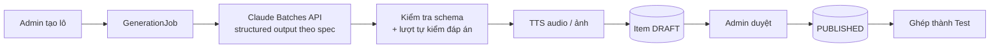
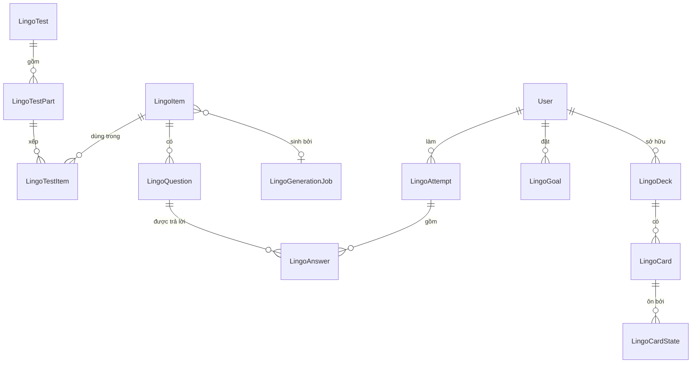

# Lingo – app học ngoại ngữ và luyện thi

App thứ năm trong launcher (`/lingo`), cạnh Hellos, Chat, Files và Studio. App học ngoại ngữ và luyện thi
chứng chỉ, dùng chung cho nhiều kỳ thi. **TOEIC Listening & Reading** làm đầu tiên. Thiết kế phải thêm được **IELTS**,
**HSK** (và về sau TOPIK, JLPT…) mà không đổi schema hay viết lại màn làm bài.

Tập thể dục (gym) là **app riêng** về sau (vd. `Fit`, `/fit`), không nằm trong Lingo. Phần có thể dùng chung
(mục tiêu, streak, nhắc học mỗi ngày) chỉ tách thành package khi app thứ hai thật sự cần.

> **Trạng thái:** bản thiết kế để duyệt. Các mục _Câu hỏi mở_ cần chốt trước khi code.

## 1. Tham khảo study4.com

Ghi chú từ các trang công khai của study4.com, đọc ngày 2026-11-18. Không xem được phần cần đăng nhập.

| Study4 có                                                                                                               | Lingo lấy gì                                                        |
| ----------------------------------------------------------------------------------------------------------------------- | ------------------------------------------------------------------- |
| Thư viện đề, lọc theo kỳ thi (IELTS, TOEIC, HSK 1–6, TOPIK, JLPT…), tìm kiếm, mỗi đề có số lượt làm và số bình luận     | Thư viện đề theo kỳ thi, có lọc và tìm kiếm (bình luận để sau)      |
| Trang đề có 2 chế độ: **Luyện tập** (chọn Part và giới hạn thời gian) và **Full test** (chỉ chế độ này có điểm quy đổi) | Giữ nguyên 2 chế độ này                                             |
| Mỗi Part gắn tag dạng câu (vd. `[Listening] Note/Form Completion`)                                                      | Tag dạng câu, dùng để thống kê điểm yếu                             |
| Đề rút gọn (`/tests/mini`)                                                                                              | Mini test                                                           |
| Flashcard: bộ có sẵn theo kỳ thi; tạo thẻ từ **highlight** ở trang kết quả bài thi                                      | Bộ thẻ hệ thống + bộ thẻ của tôi + thêm thẻ từ highlight            |
| [Unverified] Quảng cáo: ôn flashcard theo spaced repetition, thống kê theo ngày và dạng câu, AI chấm Speaking/Writing   | SRS (FSRS), thống kê theo dạng câu; AI chấm Writing ở giai đoạn sau |
| Khoá học trả phí, trợ giảng, cộng đồng                                                                                  | Ngoài phạm vi                                                       |

Khác study4: đề do AI sinh và admin duyệt (không sao chép đề có bản quyền), giải thích bằng tiếng Việt cho mọi câu.

## 2. Phạm vi

| Trong MVP (TOEIC)                                                  | Sau MVP                                        |
| ------------------------------------------------------------------ | ---------------------------------------------- |
| Thư viện đề TOEIC: full test và mini test, luyện theo Part         | IELTS (Listening, Reading, rồi Writing)        |
| Từ vựng: bộ thẻ hệ thống + bộ của tôi, ôn SRS, thêm từ highlight   | HSK 1–6 (thẻ có pinyin và chữ Hán)             |
| Chấm, giải thích tiếng Việt, transcript, xem lại bài               | AI chấm Writing; Speaking (cần speech-to-text) |
| Điểm dự đoán, điểm yếu theo Part và dạng câu, mục tiêu theo kỳ thi | Bình luận dưới đề, app mobile                  |
| Admin: sinh đề bằng AI, duyệt, ghép đề, xuất bản                   | Thanh toán, nhập đề từ file                    |

Người dùng: mọi tài khoản đã đăng nhập. Tiến độ riêng từng người. Đề và bộ thẻ hệ thống dùng chung.

## 3. Mô hình chung cho nhiều kỳ thi

Ý chính: **cấu trúc kỳ thi là code, nội dung là dữ liệu.**

```
Exam (TOEIC_LR, IELTS_AC, HSK3…)         ← code: packages/exam-specs
 └─ Section (Listening, Reading…)          thời gian, cách quy đổi điểm
     └─ Part (TOEIC Part 5, IELTS Recording 1, HSK 阅读 第一部分…)
         └─ dạng câu cho phép, số câu, tag dạng câu
Test (một đề)                             ← dữ liệu: DB
 └─ TestPart → Item (stimulus: văn bản / audio / ảnh)
                 └─ Question (dạng câu + đáp án + giải thích)
```

### 3.1 `packages/exam-specs` (mới)

Mỗi kỳ thi là một file khai báo. Thêm kỳ thi = thêm một file + nội dung, không migration.

```ts
// packages/exam-specs/src/toeic-lr.ts
export const toeicLr = defineExam({
  code: 'TOEIC_LR',
  name: 'TOEIC Listening & Reading',
  language: 'en',
  sections: [
    {
      code: 'L',
      name: 'Listening',
      minutes: 45,
      scoring: tableScore(TOEIC_L_TABLE), // số câu đúng → 5–495
      parts: [
        {
          code: 'P1',
          name: 'Photographs',
          count: 6,
          types: ['SINGLE_CHOICE'],
          media: ['image', 'audio'],
        },
        {
          code: 'P2',
          name: 'Question–Response',
          count: 25,
          types: ['SINGLE_CHOICE'],
          media: ['audio'],
          options: 3,
        },
        // P3, P4…
      ],
    },
    {
      code: 'R',
      name: 'Reading',
      minutes: 75,
      scoring: tableScore(TOEIC_R_TABLE),
      parts: [/* P5, P6, P7 */],
    },
  ],
  total: sum, // 10–990
  skillTags: [
    'grammar.verb-tense',
    'grammar.word-form',
    'vocab.collocation',
    'reading.inference' /*…*/,
  ],
})
```

- Dùng ở cả api (sinh đề, chấm, quy đổi điểm) và web (dựng màn chọn Part, thời gian).
- Mỗi dạng câu có **schema Zod** dùng chung cho: structured output khi sinh đề, kiểm tra ở api, form duyệt ở web.

### 3.2 Dạng câu (`QuestionType`)

| Dạng            | Dùng ở                                                                   | Chấm                   |
| --------------- | ------------------------------------------------------------------------ | ---------------------- |
| `SINGLE_CHOICE` | TOEIC mọi Part, IELTS multiple choice, HSK chọn đáp án                   | tự động                |
| `MULTI_CHOICE`  | IELTS "choose TWO letters"                                               | tự động                |
| `TRUE_FALSE_NG` | IELTS Reading True/False/Not Given, HSK nghe đúng/sai                    | tự động                |
| `GAP_FILL`      | IELTS form/note/table completion (gõ chữ, có danh sách đáp án chấp nhận) | tự động, chuẩn hoá chữ |
| `MATCHING`      | IELTS matching headings / features, HSK ghép câu – tranh                 | tự động                |
| `ORDERING`      | HSK sắp xếp từ thành câu                                                 | tự động                |
| `ESSAY`         | IELTS Writing, HSK viết đoạn                                             | AI chấm (sau MVP)      |
| `SPEAKING`      | IELTS Speaking                                                           | sau MVP                |

MVP chỉ cài `SINGLE_CHOICE`. Đáp án lưu dạng JSON theo schema của dạng câu, nên thêm dạng mới không đổi bảng.

### 3.3 Quy đổi điểm

Mỗi Section khai báo hàm quy đổi trong spec. [Unverified] Các bảng sau không có bản chính thức công khai đầy đủ, app luôn hiển thị là **điểm dự đoán**:

| Kỳ thi    | Thang                                      | Cách quy đổi trong app                     |
| --------- | ------------------------------------------ | ------------------------------------------ |
| TOEIC L&R | L 5–495, R 5–495, tổng 10–990              | bảng số câu đúng → điểm (ước tính)         |
| IELTS     | band 0–9 mỗi kỹ năng, overall làm tròn 0.5 | bảng raw /40 → band cho Listening, Reading |
| HSK       | theo cấp, có điểm đạt                      | điểm thô theo phần, tổng, đạt / chưa đạt   |

Giống study4: chỉ chế độ **Full test** mới có điểm quy đổi. Chế độ luyện chỉ có số câu đúng.

## 4. Tính năng

### 4.1 Hồ sơ theo kỳ thi

- Người học chọn kỳ thi đang ôn (có thể nhiều): mỗi kỳ có **mục tiêu** (TOEIC 650, IELTS 6.5, HSK 4 đạt) và **ngày thi** (tuỳ chọn).
- Dashboard theo kỳ thi đang chọn: thẻ cần ôn hôm nay, điểm dự đoán gần nhất và mục tiêu, 3 dạng câu yếu nhất, streak.

### 4.2 Thư viện đề (`/lingo/[exam]/tests`)

- Danh sách đề: tên, thời gian, số Part, số câu, số lượt làm, tag; lọc theo Section, tìm theo tên.
- Trang đề, 2 chế độ (như study4):
  - **Luyện tập:** chọn 1 hoặc nhiều Part, giới hạn thời gian (không giới hạn / 5–120 phút). Chấm khi nộp, có tuỳ chọn hiện đáp án ngay từng câu.
  - **Full test:** đủ Section, đúng thời gian, Listening chạy liền không tua. Có điểm quy đổi.
- Thêm **Luyện nhanh**: 10–20 câu ngẫu nhiên của 1 Part, ưu tiên câu chưa làm và dạng câu yếu.

### 4.3 Làm bài

- Màn tập trung: đồng hồ đếm ngược, bảng điều hướng câu, đánh dấu câu xem lại, phím tắt A/B/C/D.
- Highlight văn bản trong đề (Reading, transcript) để thêm vào flashcard sau.
- Tự lưu đáp án. Mất mạng hoặc đóng tab → vào lại làm tiếp.

### 4.4 Kết quả và xem lại

- Điểm (full test), số câu đúng theo Part và theo tag dạng câu, thời gian mỗi câu.
- Từng câu: đáp án đúng, giải thích tiếng Việt (vì sao đúng, vì sao từng đáp án sai, bẫy), dịch, **transcript** (Listening), từ vựng nổi bật.
- Câu sai vào **Sổ câu sai**, làm lại được. Nút "Báo câu sai" đổ về hàng chờ admin.

### 4.5 Từ vựng (SRS)

- **Bộ thẻ hệ thống** theo kỳ thi và chủ đề (TOEIC: Office, Finance…; IELTS: Environment, Education…; HSK: theo cấp).
- **Bộ thẻ của tôi:** tạo bộ, thêm thẻ tay, thêm từ **highlight** ở trang kết quả (AI điền nghĩa, phiên âm, ví dụ).
- Mặt thẻ tuỳ ngôn ngữ: tiếng Anh có IPA; tiếng Trung có chữ Hán, **pinyin**, Hán Việt. Có audio phát âm.
- Ôn: lật thẻ → tự chấm **Again / Hard / Good / Easy**, lịch ôn theo FSRS (`ts-fsrs`). Giới hạn thẻ mới mỗi ngày.

### 4.6 Admin (role `ADMIN`)

- **Lô sinh nội dung:** kỳ thi, Part, độ khó, chủ đề, số lượng → chạy nền.
- **Duyệt:** xem, sửa, nghe audio, Duyệt / Loại. Chỉ nội dung đã duyệt mới hiện cho người học.
- **Ghép đề:** chọn các Item đã duyệt theo cấu trúc spec thành một Test (có nút "ghép tự động đủ cấu trúc"), xuất bản.

## 5. Sinh nội dung bằng AI



- Người học **không bao giờ chờ AI**: chỉ lấy nội dung đã duyệt. Ngoại lệ: điền thẻ từ highlight (1 request ngắn).
- Model `claude-opus-5-5`, thinking adaptive, effort `high` khi sinh đề. Structured outputs
  (`client.messages.parse` + `zodOutputFormat`) với schema Zod của dạng câu trong `exam-specs`.
- Prompt dựng từ spec: mô tả Part, dạng câu, độ khó, tag; phần cố định để trong system prompt có prompt caching.
- Message Batches API (rẻ hơn 50%). Lượt tự kiểm: model làm lại câu (không kèm đáp án), lệch → `NEEDS_REVIEW`.
- Chống trùng bằng `contentHash` + danh sách chủ đề đã sinh. Kiểm tra `stop_reason` (refusal) trước khi đọc kết quả.
- `ANTHROPIC_API_KEY` chỉ có trong `.env` server, không gửi xuống web.

[Inference] Ước tính chi phí (chưa đo, phải đo lại bằng `usage` thật): một câu TOEIC Part 5 kèm giải thích
khoảng 500–800 token đầu ra, chưa tính thinking. Với giá $4 / $20 mỗi 1M token và giảm 50% của Batches,
1.000 câu khoảng $5–8 đầu ra. Bài đọc IELTS (khoảng 900 từ + 13 câu) dài hơn nhiều.

Audio và ảnh cần dịch vụ khác (Claude không có TTS, không sinh ảnh). File lưu ở bucket S3 của môi trường, phát qua URL ký tạm.

## 6. Mô hình dữ liệu (Prisma, tiền tố `Lingo`)



| Model                | Trường chính                                                                                                                                                                                                    |
| -------------------- | --------------------------------------------------------------------------------------------------------------------------------------------------------------------------------------------------------------- |
| `LingoItem`          | `exam`, `section`, `part` (mã trong spec), `difficulty`, `topic`, `content` (JSON: văn bản, transcript), `audioKey?`, `imageKey?`, `status` (DRAFT, NEEDS_REVIEW, PUBLISHED, REJECTED), `jobId?`, `contentHash` |
| `LingoQuestion`      | `itemId`, `order`, `type` (`QuestionType`), `prompt` (JSON), `answer` (JSON), `explanationVi`, `skillTags[]`                                                                                                    |
| `LingoTest`          | `exam`, `title`, `kind` (FULL, MINI), `status`, `attemptCount`                                                                                                                                                  |
| `LingoTestPart`      | `testId`, `section`, `part`, `order`                                                                                                                                                                            |
| `LingoTestItem`      | `testPartId`, `itemId`, `order`                                                                                                                                                                                 |
| `LingoAttempt`       | `userId`, `exam`, `testId?`, `mode` (PRACTICE, FULL_TEST, QUICK), `parts[]`, `timeLimitSec?`, `startedAt`, `submittedAt?`, `scores` (JSON theo Section)                                                         |
| `LingoAnswer`        | `attemptId`, `questionId`, `response` (JSON), `correct?`, `timeMs`, `flagged`                                                                                                                                   |
| `LingoGoal`          | `userId`, `exam`, `target` (JSON: 650 / 6.5 / đạt), `examDate?`, `newCardsPerDay`                                                                                                                               |
| `LingoDeck`          | `exam?`, `ownerId?` (null = hệ thống), `title`, `language` (en, zh…)                                                                                                                                            |
| `LingoCard`          | `deckId`, `term`, `reading?` (IPA / pinyin), `meaningVi`, `example?`, `exampleVi?`, `audioKey?`, `extra` (JSON: Hán Việt…)                                                                                      |
| `LingoCardState`     | `userId`, `cardId`, trạng thái FSRS (`due`, `stability`, `difficulty`, `reps`, `lapses`, `state`), `lastReview`                                                                                                 |
| `LingoHighlight`     | `userId`, `attemptId`, `questionId?`, `text`, `cardId?`                                                                                                                                                         |
| `LingoGenerationJob` | `exam`, `part`, `params` (JSON), `batchId`, `status`, `requested`, `succeeded`, `failed`, `usage`, `createdBy`                                                                                                  |

- `exam`, `section`, `part` là chuỗi mã trong `exam-specs` (không phải enum Prisma), nên thêm kỳ thi không cần migration. Api kiểm tra mã hợp lệ bằng spec.
- Sổ câu sai, thống kê dạng câu, streak tính từ `LingoAnswer` / `LingoCardState`.

## 7. API (`apps/api/src/lingo`)

Mọi route cần đăng nhập. Route admin có `@Roles(Role.ADMIN)`. Controller có `ThrottlerGuard`. `:exam` là mã trong spec.

| Method + path                                                   | Việc                                                                         |
| --------------------------------------------------------------- | ---------------------------------------------------------------------------- |
| `GET /lingo/exams`                                              | Danh sách kỳ thi đang mở (từ spec)                                           |
| `GET/PUT /lingo/goals/:exam`                                    | Mục tiêu, ngày thi, cài đặt                                                  |
| `GET /lingo/:exam/dashboard`                                    | Thẻ cần ôn, điểm dự đoán, dạng câu yếu, streak                               |
| `GET /lingo/:exam/tests` · `GET /lingo/tests/:id`               | Thư viện đề (`ListQueryDto`), chi tiết đề                                    |
| `POST /lingo/attempts`                                          | `{ exam, testId?, mode, parts?, timeLimitSec? }` → câu hỏi (không có đáp án) |
| `PUT /lingo/attempts/:id/answers/:questionId`                   | Tự lưu đáp án, đánh dấu                                                      |
| `POST /lingo/attempts/:id/submit`                               | Nộp → điểm, đúng/sai, giải thích                                             |
| `GET /lingo/attempts` · `GET /lingo/attempts/:id`               | Lịch sử, xem lại                                                             |
| `GET /lingo/:exam/mistakes`                                     | Sổ câu sai                                                                   |
| `POST /lingo/highlights`                                        | Lưu highlight, tuỳ chọn tạo thẻ                                              |
| `GET/POST /lingo/decks` · `POST /lingo/decks/:id/cards`         | Bộ thẻ, thêm thẻ                                                             |
| `GET /lingo/review` · `POST /lingo/cards/:id/review`            | Hàng ôn hôm nay, chấm thẻ                                                    |
| `POST /lingo/questions/:id/report`                              | Báo câu sai                                                                  |
| `/lingo/admin/jobs`, `/lingo/admin/items`, `/lingo/admin/tests` | Sinh, duyệt, ghép đề                                                         |

Đáp án và giải thích không trả về trước khi câu đó được nộp.

## 8. Màn hình web (`apps/web/app/(app)/lingo`)

| Route                            | Nội dung                                               |
| -------------------------------- | ------------------------------------------------------ |
| `/lingo`                         | Chọn kỳ thi (TOEIC; IELTS, HSK hiện "Sắp có")          |
| `/lingo/[exam]`                  | Dashboard kỳ thi                                       |
| `/lingo/[exam]/tests`            | Thư viện đề                                            |
| `/lingo/tests/[id]`              | Trang đề: Luyện tập (chọn Part, thời gian) / Full test |
| `/lingo/attempts/[id]`           | Làm bài                                                |
| `/lingo/attempts/[id]/result`    | Kết quả, xem lại, highlight → flashcard                |
| `/lingo/[exam]/mistakes`         | Sổ câu sai                                             |
| `/lingo/decks` · `/lingo/review` | Bộ thẻ, phiên ôn (Space lật, 1–4 chấm)                 |
| `/lingo/admin`                   | Lô sinh, duyệt, ghép đề (chỉ admin)                    |

Màn làm bài dựng từ spec + `type` của câu: mỗi `QuestionType` một component (`SingleChoice`, `GapFill`…).
Thêm kỳ thi mới không cần màn mới. Giao diện theo skill `ui-ux-pro-max`, component `@repo/ui`, kiểm tra light và dark.

## 9. Lộ trình

| Giai đoạn | Nội dung                                                                                                | Kết quả dùng được           |
| --------- | ------------------------------------------------------------------------------------------------------- | --------------------------- |
| 1         | `exam-specs` (TOEIC), schema, sinh + duyệt Part 5, luyện nhanh Part 5, bộ thẻ hệ thống + SRS, dashboard | Học từ vựng + ngữ pháp      |
| 2         | Part 6, 7; ghép đề; thư viện đề; chế độ Luyện tập theo Part; highlight → thẻ                            | Luyện đủ Reading như study4 |
| 3         | TTS, Listening Part 1–4                                                                                 | Luyện đủ Listening          |
| 4         | Full test + điểm quy đổi, mini test, điểm dự đoán theo thời gian                                        | Thi thử TOEIC đầy đủ        |
| 5         | IELTS Listening + Reading (`GAP_FILL`, `TRUE_FALSE_NG`, `MATCHING`, `MULTI_CHOICE`)                     | Kỳ thi thứ hai              |
| 6         | HSK (thẻ pinyin, `ORDERING`), AI chấm IELTS Writing                                                     | Kỳ thi thứ ba               |

Mỗi giai đoạn: PR vào `develop` → tự lên **dev**, rồi theo release lên stg và prod.

## 10. Câu hỏi mở

1. **TTS:** Google Cloud TTS, Azure Speech, Amazon Polly, ElevenLabs? Cần giọng Anh (Mỹ / Anh / Úc / Canada) và
   tiếng Trung phổ thông (HSK). Mình chưa kiểm tra giá hiện tại.
2. **Ảnh TOEIC Part 1:** AI sinh ảnh / ảnh stock miễn phí + Claude viết câu mô tả / tạm bỏ Part 1.
3. **Anthropic API key và ngân sách tháng:** môi trường nào sinh đề?
4. **Nội dung dùng chung giữa dev / stg / prod?** Mỗi môi trường DB riêng: cần lệnh export/import đề đã duyệt không?
5. **Bảng quy đổi điểm:** chấp nhận bảng ước tính ở MVP, hiệu chỉnh sau?

## 11. Quyết định cần ADR

- `0012` Cấu trúc kỳ thi khai báo bằng code (`packages/exam-specs`), nội dung trong DB; mã kỳ thi / Part là chuỗi, không phải enum.
- `0013` Sinh nội dung bằng Claude qua Batches API, bắt buộc admin duyệt trước khi xuất bản.
- `0014` Text-to-speech (sau khi chốt câu hỏi mở 1).
