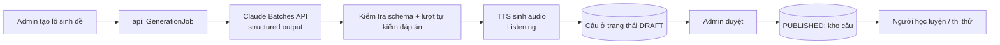
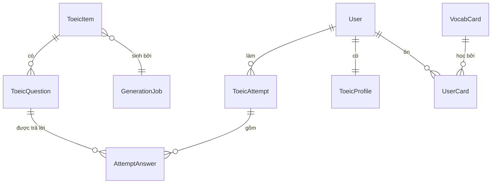

# TOEIC – app luyện thi TOEIC

App thứ năm trong launcher (`/toeic`), cạnh Hellos, Chat, Files và Studio. Mục tiêu: một người tự học
TOEIC Listening & Reading mỗi ngày (từ vựng, luyện từng Part, thi thử), biết mình đang ở khoảng điểm nào
và yếu ở đâu.

> **Trạng thái:** bản thiết kế để duyệt. Các mục _Câu hỏi mở_ cần chốt trước khi code.

## 1. Phạm vi

| Trong MVP                                                     | Ngoài MVP (sau)                 |
| ------------------------------------------------------------- | ------------------------------- |
| Từ vựng TOEIC theo chủ đề, ôn lặp lại ngắt quãng (SRS)        | Speaking & Writing              |
| Luyện Reading Part 5, 6, 7, chấm và giải thích tiếng Việt     | App mobile (`apps/mobile`)      |
| Luyện Listening Part 1–4, audio sinh bằng text-to-speech      | Bảng xếp hạng, học nhóm         |
| Thi thử (mini và full), quy đổi điểm ước tính 10–990          | Lộ trình học tự động (AI coach) |
| Theo dõi tiến độ: điểm dự đoán, điểm yếu theo Part và kỹ năng | Thanh toán, gói trả phí         |
| Trang admin: sinh đề bằng AI, duyệt, xuất bản                 | Nhập đề từ file (CSV/JSON)      |

Người dùng: mọi tài khoản đã đăng nhập. Mỗi người có tiến độ riêng. Câu hỏi và từ vựng dùng chung.

**Nội dung đề:** không sao chép đề ETS (có bản quyền). Mọi câu hỏi do AI sinh theo đúng format TOEIC,
được admin duyệt trước khi người học thấy.

## 2. Format TOEIC Listening & Reading

| Phần      | Part | Dạng                       | Số câu (đề full) | Kích thích (stimulus)           |
| --------- | ---- | -------------------------- | ---------------- | ------------------------------- |
| Listening | 1    | Mô tả tranh                | 6                | 1 ảnh + 4 câu đọc (audio)       |
| Listening | 2    | Hỏi – đáp                  | 25               | 1 câu hỏi + 3 đáp án (audio)    |
| Listening | 3    | Hội thoại ngắn             | 39 (13 × 3)      | Hội thoại 2–3 người (+ biểu đồ) |
| Listening | 4    | Bài nói ngắn               | 30 (10 × 3)      | Bài nói 1 người (+ biểu đồ)     |
| Reading   | 5    | Điền câu chưa hoàn chỉnh   | 30               | 1 câu                           |
| Reading   | 6    | Điền đoạn văn              | 16 (4 × 4)       | Đoạn văn có 4 chỗ trống         |
| Reading   | 7    | Đọc hiểu đơn, kép, ba đoạn | 54               | 1–3 văn bản (email, quảng cáo…) |

Đề full: 200 câu, Listening 45 phút, Reading 75 phút. Mỗi phần quy đổi 5–495 điểm, tổng 10–990.

[Unverified] Bảng quy đổi điểm chính thức của ETS không công khai và thay đổi theo từng đề. App dùng bảng
quy đổi **ước tính** (số câu đúng → điểm), luôn hiển thị là "điểm dự đoán", không phải điểm thật.

## 3. Tính năng

### 3.1 Bắt đầu

1. Lần đầu vào `/toeic`: chọn **điểm mục tiêu** (vd. 650) và **ngày thi** (tuỳ chọn).
2. Làm **bài kiểm tra đầu vào** (mini test khoảng 40 câu, trộn đủ 7 Part) → điểm dự đoán ban đầu.
3. Dashboard gợi ý mỗi ngày: số thẻ từ vựng cần ôn, 1 bài luyện Part yếu nhất.

### 3.2 Từ vựng (SRS)

- Bộ thẻ theo chủ đề TOEIC: Office, Finance, Marketing, Travel, HR, Manufacturing, Health…
- Thẻ: từ, loại từ, phiên âm IPA, nghĩa tiếng Việt, câu ví dụ ngữ cảnh công sở, audio phát âm (TTS),
  collocation hay gặp trong đề.
- Ôn tập: hiện mặt trước → người học tự chấm **Again / Hard / Good / Easy** → hẹn lần ôn tiếp.
  Thuật toán: [FSRS](https://github.com/open-spaced-repetition/fsrs4anki) (thư viện `ts-fsrs`), lưu trạng thái thẻ theo từng người.
- Giới hạn mỗi ngày: số thẻ mới (mặc định 20) và số thẻ ôn, người học tự chỉnh.
- Từ gặp trong bài luyện có thể **thêm vào bộ thẻ của tôi** bằng 1 nút.

### 3.3 Luyện theo Part

- Chọn Part (1–7), độ khó (Dễ / Vừa / Khó, tương ứng khoảng 400 / 650 / 850+), số câu (10 / 20).
- Hai chế độ:
  - **Luyện:** chấm từng câu ngay, hiện giải thích tiếng Việt (vì sao đáp án đúng, vì sao từng đáp án sai,
    bẫy hay gặp), dịch câu/đoạn, từ vựng nổi bật.
  - **Tính giờ:** chấm cuối bài, thời gian theo nhịp đề thật.
- Listening: nghe audio (tốc độ 0.75× / 1× / 1.25×), sau khi nộp mới hiện transcript.
- Mỗi câu có **tag kỹ năng** (vd. `grammar.verb-tense`, `grammar.word-form`, `vocab.collocation`,
  `reading.inference`, `listening.indirect-answer`) để thống kê điểm yếu.
- Câu sai tự vào **Sổ câu sai**, làm lại được.

### 3.4 Thi thử

- **Mini test:** khoảng 50 câu (L 25, R 25), khoảng 40 phút.
- **Full test:** 200 câu, 120 phút, đúng cấu trúc ở mục 2. Listening chạy liền mạch, không tua lại (như thi thật).
- Kết quả: điểm dự đoán L/R/tổng, đúng/sai theo Part và theo tag kỹ năng, xem lại từng câu kèm giải thích.
- Đề thi thử được ghép từ kho câu đã duyệt, mỗi người ưu tiên câu chưa làm.

### 3.5 Tiến độ

- Biểu đồ điểm dự đoán theo thời gian, so với mục tiêu.
- Độ chính xác theo Part và theo tag kỹ năng (5 điểm yếu nhất).
- Streak ngày học, số thẻ đã thuộc, số câu đã làm.

### 3.6 Admin (role `ADMIN`)

- Tạo **lô sinh đề**: Part, độ khó, chủ đề, số lượng → chạy nền.
- Duyệt câu: xem, sửa, nghe audio, **Duyệt / Loại**. Chỉ câu đã duyệt mới vào kho cho người học.
- Báo lỗi từ người học (nút "Báo câu sai") đổ về hàng chờ duyệt.

## 4. Sinh nội dung bằng AI

- **Không sinh khi người học đang chờ.** Người học chỉ lấy câu từ kho đã duyệt. Mọi lần sinh đề chạy nền.
- **Model:** `claude-opus-5-5`, thinking adaptive, effort `high` khi sinh đề (cần đúng ngữ pháp, đúng
  đáp án, bẫy hợp lý).
- **Định dạng:** structured outputs (`client.messages.parse` + `zodOutputFormat`), mỗi Part một schema
  Zod. Schema dùng chung cho kiểm tra ở api và form duyệt ở web.
- **Chi phí:** dùng Message Batches API (rẻ hơn 50% so với gọi thường, chạy bất đồng bộ). Phần mô tả
  format và quy tắc của từng Part đặt trong system prompt cố định, có prompt caching.
- **Lượt tự kiểm:** một request thứ hai đưa câu hỏi đã sinh (không kèm đáp án) cho model làm lại. Kết quả
  khác đáp án đã sinh → đánh dấu `NEEDS_REVIEW` cho admin.
- **Chống trùng:** lưu hash nội dung và chủ đề đã sinh. Lô sau truyền danh sách chủ đề cần tránh.
- **Refusal:** kiểm tra `stop_reason` trước khi đọc kết quả. Câu bị từ chối ghi lỗi vào job, không lưu.
- **Key:** `ANTHROPIC_API_KEY` chỉ có trong `.env` của server (theo môi trường), không bao giờ gửi xuống web.

[Inference] Ước tính chi phí (chưa đo, phải đo lại bằng `usage` thật sau lô đầu tiên): một câu Part 5 kèm
giải thích khoảng 500–800 token đầu ra, chưa tính token thinking. Với giá Opus 5.5 ($4 / $20 mỗi 1M token)
và giảm 50% của Batches, 1.000 câu Part 5 có đầu ra khoảng $5–8. Part 3, 4, 6, 7 dài hơn nhiều lần.

### Audio (Listening) và ảnh (Part 1)

Claude không có text-to-speech và không sinh ảnh, nên phần này cần dịch vụ khác (xem _Câu hỏi mở_):

- **Audio:** script do Claude sinh (gán giọng Mỹ / Anh / Úc / Canada cho từng người nói như đề thật) → TTS
  → file `.mp3` lưu trong bucket S3 của môi trường (RustFS), phát qua URL ký tạm.
- **Part 1:** cần ảnh có người và vật trong khung cảnh công sở. Các lựa chọn ở _Câu hỏi mở_.

## 5. Mô hình dữ liệu (Prisma, schema `toeic_*`)

| Model           | Trường chính                                                                                                                                                                                      |
| --------------- | ------------------------------------------------------------------------------------------------------------------------------------------------------------------------------------------------- |
| `ToeicItem`     | Một stimulus: `part` (1–7), `difficulty`, `topic`, `passages` (JSON: văn bản / transcript), `audioKey?`, `imageKey?`, `status` (DRAFT, NEEDS_REVIEW, PUBLISHED, REJECTED), `jobId`, `contentHash` |
| `ToeicQuestion` | `itemId`, `order`, `prompt?`, `options` (3 hoặc 4), `answer`, `explanationVi`, `translationVi?`, `skillTags[]`                                                                                    |
| `ToeicAttempt`  | `userId`, `mode` (PRACTICE, TIMED, MINI_TEST, FULL_TEST, PLACEMENT), `part?`, `startedAt`, `submittedAt?`, `listeningScore?`, `readingScore?`                                                     |
| `AttemptAnswer` | `attemptId`, `questionId`, `choice?`, `correct`, `timeMs`                                                                                                                                         |
| `ToeicProfile`  | `userId`, `targetScore`, `examDate?`, `newCardsPerDay`, `streak`, `lastStudyDate`                                                                                                                 |
| `VocabCard`     | `word`, `pos`, `ipa`, `meaningVi`, `example`, `exampleVi`, `topic`, `audioKey?`, `status`                                                                                                         |
| `UserCard`      | `userId`, `cardId`, trạng thái FSRS (`due`, `stability`, `difficulty`, `reps`, `lapses`, `state`), `lastReview`                                                                                   |
| `GenerationJob` | `part` / `kind`, `params` (JSON), `batchId`, `status`, `requested`, `succeeded`, `failed`, `usage` (token), `createdBy`                                                                           |

Sổ câu sai và thống kê điểm yếu được tính từ `AttemptAnswer`, không cần bảng riêng.

## 6. API (`apps/api/src/toeic`)

Mọi route cần đăng nhập (mặc định của api). Route admin thêm `@Roles(Role.ADMIN)`. Controller đều có `ThrottlerGuard`.

| Method + path                                             | Việc                                                                                  |
| --------------------------------------------------------- | ------------------------------------------------------------------------------------- |
| `GET/PATCH /toeic/profile`                                | Mục tiêu, ngày thi, cài đặt                                                           |
| `GET /toeic/dashboard`                                    | Thẻ cần ôn, điểm dự đoán, điểm yếu, streak                                            |
| `GET /toeic/vocab/review`                                 | Hàng đợi thẻ hôm nay (mới + đến hạn)                                                  |
| `POST /toeic/vocab/cards/:id/review`                      | Chấm 1 thẻ (Again / Hard / Good / Easy)                                               |
| `POST /toeic/attempts`                                    | Bắt đầu bài: `{ mode, part?, difficulty?, count? }` → danh sách câu (không có đáp án) |
| `PUT /toeic/attempts/:id/answers/:questionId`             | Lưu đáp án (tự lưu khi đang làm)                                                      |
| `POST /toeic/attempts/:id/submit`                         | Nộp → điểm, đúng/sai, giải thích                                                      |
| `GET /toeic/attempts` · `GET /toeic/attempts/:id`         | Lịch sử, xem lại bài                                                                  |
| `GET /toeic/mistakes`                                     | Sổ câu sai (list chuẩn `ListQueryDto`)                                                |
| `POST /toeic/questions/:id/report`                        | Báo câu sai                                                                           |
| `POST /toeic/admin/jobs` · `GET /toeic/admin/jobs`        | Tạo, xem lô sinh đề                                                                   |
| `GET /toeic/admin/items` · `PATCH /toeic/admin/items/:id` | Hàng chờ duyệt, sửa, duyệt / loại                                                     |

Đáp án và giải thích **không** được trả về trước khi câu đó được nộp (chế độ luyện: nộp từng câu).

## 7. Màn hình web (`apps/web/app/(app)/toeic`)

| Route                         | Nội dung                                                            |
| ----------------------------- | ------------------------------------------------------------------- |
| `/toeic`                      | Dashboard: điểm dự đoán và mục tiêu, việc hôm nay, điểm yếu, streak |
| `/toeic/vocab`                | Bộ thẻ theo chủ đề, nút "Ôn ngay"                                   |
| `/toeic/vocab/review`         | Phiên ôn thẻ (bàn phím: Space lật thẻ, 1–4 chấm)                    |
| `/toeic/practice`             | Chọn Part, độ khó, số câu, chế độ                                   |
| `/toeic/attempts/[id]`        | Làm bài: câu hỏi, audio, đồng hồ, bảng điều hướng câu               |
| `/toeic/attempts/[id]/result` | Kết quả, xem lại từng câu kèm giải thích                            |
| `/toeic/tests`                | Mini test, full test, lịch sử điểm                                  |
| `/toeic/mistakes`             | Sổ câu sai                                                          |
| `/toeic/admin`                | Lô sinh đề, hàng chờ duyệt (chỉ admin)                              |

Thiết kế giao diện theo skill `ui-ux-pro-max`, dùng component `@repo/ui`, kiểm tra cả light và dark.
Màn làm bài ưu tiên tập trung: ít chrome, chữ đọc lớn, phím tắt A/B/C/D.

## 8. Lộ trình

| Giai đoạn | Nội dung                                                                                       | Kết quả dùng được               |
| --------- | ---------------------------------------------------------------------------------------------- | ------------------------------- |
| 1         | Schema, pipeline sinh đề + duyệt (Reading Part 5), luyện Part 5, từ vựng SRS, dashboard cơ bản | Học từ vựng + ngữ pháp mỗi ngày |
| 2         | Part 6, 7; mini test Reading; điểm yếu theo tag                                                | Luyện đủ Reading                |
| 3         | TTS + Listening Part 2, 3, 4; Part 1 theo phương án ảnh đã chọn                                | Luyện đủ Listening              |
| 4         | Full test, bài kiểm tra đầu vào, điểm dự đoán theo thời gian                                   | Thi thử đầy đủ                  |

Mỗi giai đoạn: PR vào `develop` → tự lên **dev** để thử, rồi theo release lên stg và prod.

## 9. Câu hỏi mở (cần chốt trước khi code)

1. **TTS cho Listening:** dịch vụ nào? Ứng viên: Google Cloud Text-to-Speech, Azure Speech, Amazon
   Polly, ElevenLabs. Tiêu chí: giọng Mỹ / Anh / Úc / Canada tự nhiên, giá, có free tier. Mình chưa kiểm tra giá
   hiện tại của các dịch vụ này.
2. **Ảnh Part 1:** (a) dịch vụ sinh ảnh AI, (b) ảnh stock miễn phí (Unsplash, Pexels) + Claude viết câu
   mô tả từ ảnh (Claude đọc được ảnh), (c) tạm bỏ Part 1 ở MVP.
3. **Anthropic API key và ngân sách:** dùng key nào, giới hạn chi mỗi tháng bao nhiêu? Key đặt ở môi trường
   nào (chỉ prod sinh đề, dev/stg dùng kho câu nhỏ để thử?).
4. **Kho câu dùng chung giữa các môi trường?** Mỗi môi trường có DB riêng: câu duyệt trên prod có cần đồng bộ
   xuống dev/stg không, hay mỗi nơi sinh riêng?
5. **Bảng quy đổi điểm ước tính:** chấp nhận bảng tuyến tính đơn giản ở MVP, hiệu chỉnh sau?

## 10. Quyết định cần ADR

- `0012` Sinh nội dung học bằng Claude qua Batches API, bắt buộc admin duyệt trước khi xuất bản.
- `0013` Text-to-speech cho Listening (sau khi chốt câu hỏi mở 1).
